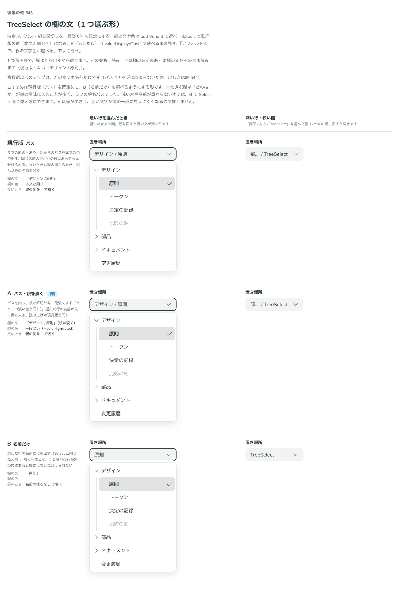

# 0515. TreeSelect は欄にパスを出し、親と区切りを一段淡くするのが既定。親の色は本文と同じにも、名前だけにも選べる

- ステータス: Accepted
- 日付: 2026-10-16
- ラウンド: 後半 軸 643

## 背景

TreeSelect（1 つ選ぶ形）の欄に、選んだ行をどう出すかを決める必要がありました。木を選ぶ欄は「どの枝か」が値の意味に入ることが多く、同じ名前の行が別の枝にあることもあります。どの案も、読み上げは欄の名前のあとに欄の文をそのまま読みます。

## 候補

| 案        | 欄の文               | 親の色            | 長いとき              |
| --------- | -------------------- | ----------------- | --------------------- |
| 現行版    | 「デザイン / 原則」  | 本文と同じ        | 親の側を … で省く     |
| A（採用） | 「デザイン / 原則」  | 一段淡い（muted） | 親の側を … で省く     |
| B         | 「原則」（名前だけ） | なし              | 名前の後ろを … で省く |

## 決定

**A（パスを出し、親と区切りを一段淡くする）を既定にします。** 親の文字色は `pathVariant` で選べ、`'default'` で現行版の形（本文と同じ色）になります。B の名前だけは `valueDisplay="last"` で選べます。パスの区切りは `separator` で変えられます（ADR-0516 と同じ名前と型）。

## 理由

ユーザーの返事の原文です。

> 643 デフォルトAで、親の文字色が選べる、でよさそう

2 回目の返事では、「643 今の見た目で良さそう」とも返事がありました。

以下は、決めたときの考えです。

- **どの枝かが値の一部**: 木から選ぶ値は、親からのパスで意味が決まることが多いため、パスを既定にします。同じ名前が別の枝にあっても欄で見分けられます
- **選んだ行の名前が先に目に入る**: 親と区切りを淡くすると、パスを出しながら、選んだ行の名前が先に読めます（原則 6 の淡い文字）
- **文字の色は使う側の場面で変わる**: 淡い親が読みにくい背景もあります。色は部品が決め切らず、選べる形にします（原則 20）

## 却下した案と理由

- **現行版（本文と同じ色）を既定にすること**: 親と選んだ行が同じ濃さで並び、選んだ行がどれかを読み取る手間が増えます。`pathVariant="default"` で選べる形に残しました
- **B（名前だけ）を既定にすること**: 短く収まり Select と同じ見え方ですが、同じ名前の行が別の枝にあると欄だけでは見分けられません。`valueDisplay="last"` で選べる形に残しました

## 影響

- `src/components/tree-select/TreeSelect.tsx`: `valueDisplay`（`'path'`・`'last'`。1 つ選ぶ形の既定は `'path'`）・`pathVariant`（`'muted'`・`'default'`、既定 `'muted'`）・`separator`（既定 `'/'`、`null` で区切らない）を持ちます
- 長いときは親の側から省き、選んだ行の名前を残します
- 複数選ぶ形のチップは、同じ `valueDisplay` に従います（ADR-0516）

## 原則への反映

反映なし。原則 6 と原則 20 の範囲内です。

決めた時点のコミットは `1982ef2d` です。

## 比較画像

