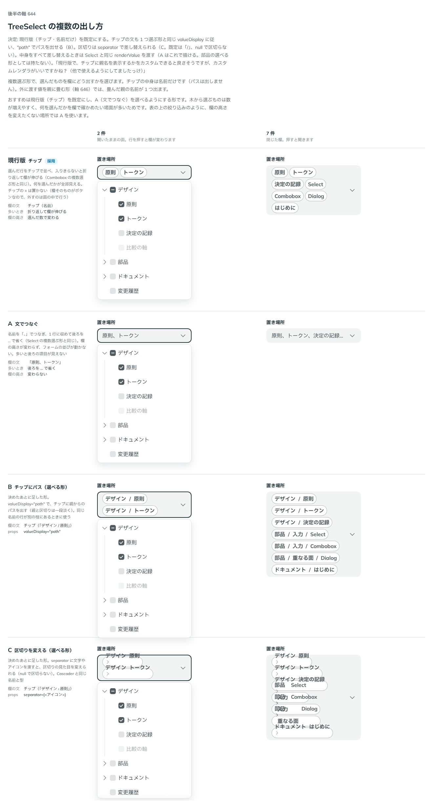

# 0516. TreeSelect の複数選ぶ形は、名前だけのチップが既定。出し方は valueDisplay・separator・renderValue で変えられる

- ステータス: Accepted
- 日付: 2026-10-16
- ラウンド: 後半 軸 644

## 背景

TreeSelect（複数選ぶ形）の欄に、選んだものをどう出すかを決める必要がありました。1 つ選ぶ形はパスを出します（ADR-0515）が、パスは複数のチップには収まりにくくなります。

## 候補

| 案             | 欄の文                        | 多いとき             | 欄の高さ         |
| -------------- | ----------------------------- | -------------------- | ---------------- |
| 現行版（採用） | チップ（名前だけ）            | 折り返して欄が伸びる | 選んだ数で変わる |
| A              | 「原則、トークン」            | 後ろを … で省く      | 変わらない       |
| B（選べる形）  | チップ（「デザイン / 原則」） | 折り返して欄が伸びる | 選んだ数で変わる |
| C（選べる形）  | チップ（「デザイン › 原則」） | 折り返して欄が伸びる | 選んだ数で変わる |

B と C は、決めたあとに足した選べる形です。A は部品の選べる形としては持たず、`renderValue` で描きます。

## 決定

**現行版（名前だけのチップ）を既定にします。** チップの文も、1 つ選ぶ形と同じ `valueDisplay` に従い、`"path"` でパスを出せます（B）。パスの区切りは `separator` で差し替えられ、文字のほかアイコンも渡せます（C。既定は「/」、`null` で区切らない）。中身をすべて差し替えるときは、Select と同じ `renderValue` を渡します（A はこれで描けます）。

## 理由

ユーザーの返事の原文です。

> 現行版で、チップに親名を表示するかをカスタムできると良さそうですが、カスタムレンダラがいいですかね？（他で使えるようにしてましたっけ）

「他で使えるように」は、Select の `renderValue` を指します。同じ名前と型で TreeSelect にも持たせました。

以下は、決めたときの考えです。

- **何を選んだかが全部見える**: 木から選ぶものは数が増えやすく、欄で確かめたい場面が多いため、チップで全部出します（Combobox の複数選ぶ形と同じ）
- **チップにパスは収まらない**: 既定は名前だけにし、同じ名前が別の枝にあるときだけ、使う側が `valueDisplay="path"` で出します
- **細かい見せ方は renderValue に任せる**: 区切りのような一部の差は props にし、全部の差し替えは `renderValue` にして、props を増やしすぎません（原則 20）

## 却下した案と理由

- **A（文でつなぐ）を選べる形に持つこと**: 欄の高さが変わらない利点はありますが、`renderValue` で描けるため、専用の props は持ちません。表の上の絞り込みのように、欄の高さを変えたくない場所では `renderValue` を使います
- **チップに × を置くこと**: 欄そのものがボタンなので、外すのは面の中で行います

## 影響

- `src/components/tree-select/TreeSelect.tsx`: 複数選ぶ形の `valueDisplay` の既定は `'last'` です。`separator`・`renderValue` は ADR-0515 と共通です
- `renderValue` を書くと、`valueDisplay`・`pathVariant`・`separator` は使わず、チップも出しません
- 値を親に畳む形は採りません（ADR-0518）

## 原則への反映

反映なし。原則 20 の範囲内です。

決めた時点のコミットは `795feef0` です。

## 比較画像

