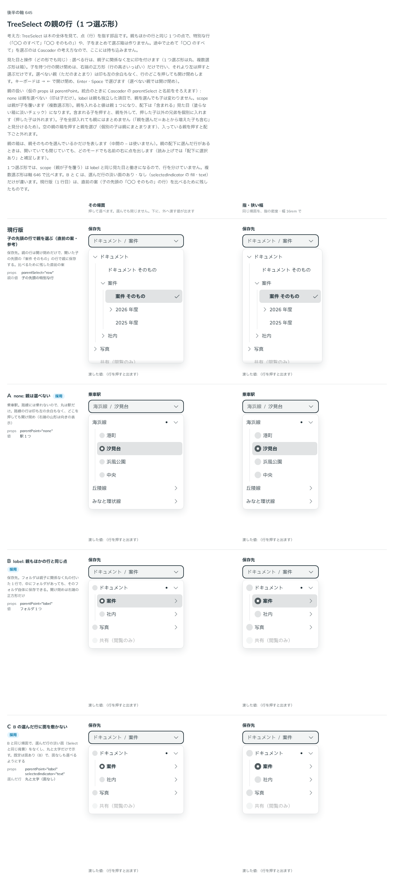

# 0517. TreeSelect の 1 つ選ぶ形は、親を選べないのが既定。親もほかの行と同じ点として選べ、選んだ行の面は外せる

- ステータス: Accepted
- 日付: 2026-10-16
- ラウンド: 後半 軸 645

## 背景

TreeSelect（1 つ選ぶ形）で、子を持つ行（親）を選べるかを決める必要がありました。乗車駅のように親（路線）が選べない場面と、保存先のフォルダのように親そのものを選びたい場面があります。

この軸は何度も作り直しました。試した案は次のとおりです。子の先頭に「〇〇 のすべて／そのもの」の行を置く形（Cascader の形）、1 段ずつ進む面、親の行を 2 つに割る形、検索を主にする形、左の帯で選ぶ形、開け閉めをなくす形、一括の箱と先頭の行の組み合わせ。どれも「親を特別に分離する仕組み」が増え、見た目の説明が重くなりました。

## 候補

最後に比べた案です。

| 案                       | 親の行                                   | 選べるもの    | 選んだ行の面         |
| ------------------------ | ---------------------------------------- | ------------- | -------------------- |
| 現行版（参考。直前の案） | 開け閉めだけ。子の先頭の特別な行で選ぶ   | フォルダ      | あり                 |
| A（採用）                | 印も余白もなし。どこを押しても開け閉め   | 駅だけ        | あり                 |
| B（選べる形）            | ほかの行と同じ丸。開け閉めは右端の正方形 | フォルダ 1 つ | あり                 |
| C（選べる形）            | B と同じ                                 | フォルダ 1 つ | なし（丸と太字だけ） |

## 決定

**親を選べない形（`parentSelect="none"`）を既定にします。** 選べる行は、親子に関係なく左に丸の印を置きます。子を持つ行の開け閉めは、右端の行の高さの正方形だけです。選べない親は、印も左の余白もなく、行のどこを押しても開け閉めします。

親も選べるようにするときは、`parentSelect="label"` にします。親もほかの行と同じ 1 つの点で、親を選んでも中の行は変わりません。

選んだ行の面は `selectedIndicator` で選びます。`'fill'`（既定）は Select と同じ淡い面、`'text'` は面を敷かず、丸と太字だけで示します。

面の高さは中身に合わせて伸び縮みします。

## 理由

ユーザーの返事の原文です。

> gmail のように親タグを選択できるニーズもありつつ、デフォルトでは親選択なし・一括選択は可でよさそう。開くトグルのボタンがかなり小さいので、そこは調整したい気持ち

> 645 この見た目にするなら、トグルは正方形にしたいですね。あとは、チェックが付けられると分かるような見た目が必要？とも思ったりしました。

> そもそも TreeSelect という概念をユーザーが知っているかどうかで、どこまで見た目で分かるように説明するべきか迷いますね。私はあまり見たことが無いのでここまで説明できる見た目を求めていますが、実際どうなんでしょうか。
> パッと思ったのは、選べるなら閉じれるようになっているのが正しくない気がしています。

> 645 正方形の押せるエリアが左端はピッタリなのに、上下にはピッタリではないのが違和感ありますね。

> これって 645 でも「そのもの」が必要な場合があるでしょうか？

> 現状のデザインにとてもしっくり来ているかというと、そういうわけではないんですよね。もう2-3案くらい、見た目の案を検討したいです。自分が TreeSelect の思想がない、というのもありそうな気がしてきました。

候補を検討するうちに、ユーザーが次のように気づきました。「親を特別に分離する仕組みに執着しすぎているのかも」。Cascader と TreeSelect の本質の違いを整理すると、次のようになります。

- Cascader は、段ごとに順に答える道筋です。値は道筋で、途中の段で決めるには、道筋の終わりを「ここまで」と示す特別な行が要ります（ADR-0520）
- TreeSelect は、木の全体から点を指す地図です。値は点で、親もほかの行と同じ点です。特別な行は要りません

「そのもの」の行が要るかという問いには、保存先のフォルダのように要る場面があります。文字はデータの意味で決まります。点として選べるようにすれば、特別な行なしで済みます。

最後の案（点のルール）への返事は次のとおりです。

> 2: C がいいかなと思っています。
> 3: 点が出るのは親切なのでいいかなと思いました。背景も良さそう。選択背景色はナシにできてもいいのかな？と思ったりしています。

> props の名前は他に沿っていれば良さそう。面の高さですが、Cascader は横に動かすのに対して、TreeSelect は縦に動かしていくものなので、今のままでいいかなと思いました。

以下は、決めたときの考えです。

- **選べる行は、親子に関係なく同じ印**: 丸があれば選べると読め、「そのもの」の行を作らずに済みます。1 つ選ぶ形の「親そのもの」の特別な行は作りません
- **開け閉めは右端の正方形だけ**: 選べる行は、行を押すと選ぶので、開け閉めは別の場所に置きます。右端の正方形に分けます（原則 17。押せる範囲は見た目の範囲）。正方形は行の高さいっぱいにして、上下にも余白を残しません
- **選べない親は行のどこでも開け閉め**: 印も余白もない行は、押せるのが開け閉めだけだと読めます。右端の山形は向きの表示です
- **選んだ行の面は外せる**: 丸と太字だけでも選んだ行は分かるため、面を敷かない形も選べるようにします。名前は Select の選んだ行の印の考え方に沿って `selectedIndicator` にしました
- **面の高さは伸び縮み**: TreeSelect は縦に開け閉めしていくものなので、段で高さを固定しません（Cascader は横に進むため、ADR-0522 で高さをそろえます）

## 却下した案と理由

- **子の先頭の「〇〇 のそのもの」の行（`parentSelect="row"`）**: 親だけ特別な行が増え、点として選べる形のほうが説明が少なく済むため、採りません。この形は Cascader の道筋の本質に合います（ADR-0520）
- **1 段ずつ進む面・左の帯で選ぶ形・検索を主にする形・開け閉めをなくす形**: TreeSelect が木の全体を見渡す地図であることから外れ、親を特別に分ける仕組みが残るため、採りません
- **親の行を 2 つに割る形・一括の箱と先頭の行の組み合わせ**: 押せる範囲が増え、選べると分かる見た目の説明も増えるため、採りません

## 影響

- `src/components/tree-select/TreeSelect.tsx`: `parentSelect`（`'none'`・`'label'`・`'scope'`、既定 `'none'`）と `selectedIndicator`（`'fill'`・`'text'`、既定 `'fill'`）を持ちます。1 つ選ぶ形では `scope` は `label` と同じです
- `parentSelect` の `self`・`row`、`parentRowLabel`、一括選択の箱は、なくなりました
- 配下に選んだ値がある親には、開いていても閉じていても名前の右に点を出します。読み上げは補足の説明（`aria-description`）で「配下に選択あり」と伝えます
- 複数選ぶ形の扱いは ADR-0518 にあります

## 原則への反映

原則 18 を書き換えました。階層から選ぶ部品は、選ぶものが道筋か点かで分け、木から点を選ぶ部品では親もほかの行と同じ点として扱う、という文を足しました。

決めた時点のコミットは `af751fa8` です。

## 比較画像

