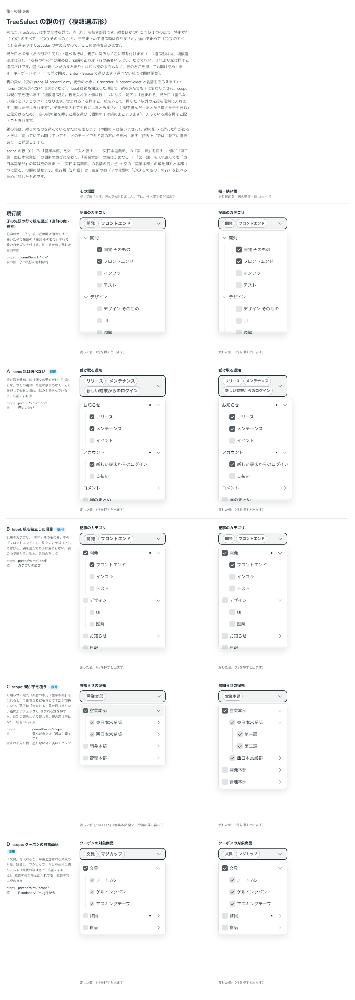

# 0518. TreeSelect の複数選ぶ形は、親を選べないのが既定。parentSelect で親も独立した項目にも、配下を覆う親にも選べる

- ステータス: Accepted
- 日付: 2026-10-16
- ラウンド: 後半 軸 646

## 背景

TreeSelect（複数選ぶ形）で、親（子を持つ行）を選べるか、選んだときに値がどうなるかを決める必要がありました。通知の種類のように親を選べない場面、記事のカテゴリのように親も別の項目として付けたい場面、部署の木のように「親を選ぶと配下すべて（あとから増えた分も）」としたい場面があります。1 つ選ぶ形の決定は ADR-0517 にあります。

直前の案は、親の箱を配下の葉と連動させる一括選択（中間の − の状態あり）と、子の先頭の「〇〇 そのもの」の行でした。

## 候補

最後に比べた案です。

| 案                       | 親の行                                   | 値                                    |
| ------------------------ | ---------------------------------------- | ------------------------------------- |
| 現行版（参考。直前の案） | 開け閉めだけ。子の先頭の特別な行で選ぶ   | 親のカテゴリ                          |
| A（採用）                | 印も余白もなし。どこを押しても開け閉め   | 選んだ点（葉）の並び（通知）          |
| B（選べる形）            | 親も独立した項目。選んでも子は変わらない | カテゴリの並び                        |
| C（選べる形）            | scope。親が子を覆い、配下は「含まれる」  | 選んだ点だけ（親なら親 1 つ）（宛先） |
| D（C の確認）            | scope。クーポンの対象商品                | `["stationery","mug"]` など           |

## 決定

**親を選べない形（`parentSelect="none"`）を既定にします。** 値は、選んだ点（葉）の並びです。

親も選べるようにするときは、2 つから選びます。

- **`label`**: 親も独立した項目です。「開発」そのものも、中の「フロントエンド」も、別々のカテゴリとして付けます。親を選んでも子は変わりません
- **`scope`**: 親が子を覆います。親を入れると配下は「含まれる」見た目（塗らない箱に淡いチェック）になり、値は親 1 つです。含まれる子を押すと、親を外して残りを個別に選びます。子が全部そろっても、親にはまとめません（親を選んだ＝あとから増えた子も含む、と見分けるため）。空の親の箱を押すと、親にまとまります

親の箱は、親そのものの状態だけを表します。中間の − は使いません。配下に選んだ値がある親には、開いていても閉じていても、名前の右に点を出します。

## 理由

ユーザーの返事の原文です。

> 646 現行版デフォルトで、645 で示したような親タグとして選択できる、は欲しいです（親に畳む はナシ）

> 646 これ、モードが選べる必要がありそう。子を一括で選ぶのか、親のみを選べるのか、それぞれを識別できる見た目が必要ですね

> 646 数字が出るものは「選べる上限」と勘違いしそうなので却下かなと思いました。また、タグのしるしについても識別するには他の選択可能なものもしるしを揃える必要があるので却下かなと思いました。

> 1: 概ね良さそう。D:scope ですが、文具配下が全部選ばれているのに [-] の表記になるのがちょっと迷いますね。ここ以外は特に気にならなかったですね

> パッと思ったのは、子が選択されている時は点が付く挙動だけにして [-] にはしない、とかもありそうですね

> 開いたときに消えるのが何を示しているのか伝わりづらそうだったので、ずっと点がついていてもいいかなと思いました。props の名前は他に沿っていれば良さそう。

以下は、決めたときの考えです。

- **親を選ぶ意味はモードで決まる**: 「子を一括で選ぶ」と「親だけを選ぶ」は、見た目で見分けられる必要があります。`label` は親の箱が親そのものの状態だけ、`scope` は配下が「含まれる」見た目になり、箱の見た目が違います
- **− をなくす**: 配下が全部選ばれているのに − になる、という矛盾が出ます。親の箱は親そのものの状態だけにすると、箱は親が選ばれたか否かだけを表し、迷いません。配下の選択は点で伝えます
- **子が全部そろっても親にまとめない**: 親を選んだことは、あとから増えた子も含むという意味を持ちます。個別に全部選んだだけのときと、見分けられるようにします
- **点はずっと出す**: 開いたときに点が消えると、何を示していたのかが伝わりません。閉じていても開いていても、配下に選択があることを名前の右に出します。読み上げは補足の説明（`aria-description`）で「配下に選択あり」と伝えます
- **TreeSelect の親はほかの行と同じ点**: 値は選んだ点の並びで、親に畳む形は持ちません（ADR-0517）

## 却下した案と理由

- **親に畳む（配下が全部そろったら親 1 つの値にする）**: 親を選んだことと、個別に全部選んだことが区別できなくなるため、採りません
- **一括選択の箱（親の箱が中の葉と連動して − になる形）**: 配下が全部選ばれていても − になる矛盾があり、しるしも増えるため、採りません。`parentSelect` の `self`・`row`、`parentRowLabel` も、なくなりました
- **数が出る印・タグのしるしを親だけに付ける形**: 数は「選べる上限」と読み違えられます。しるしを親だけに付けると、識別するために選べる行すべてにしるしを揃える必要があり、重くなります
- **scope の濃い塗りで「含まれる」を示す別案**: 塗らない箱に淡いチェックのほうが、親そのものが選ばれた箱との差が分かります

## 影響

- `src/components/tree-select/TreeSelect.tsx`: `parentSelect`（`'none'`・`'label'`・`'scope'`、既定 `'none'`）を持ちます。ADR-0517 と共通です
- `none` の複数選ぶ形の値は、選んだ点（葉）の並びです
- 部署の木の確かめ（親を外して入れ直す → 含まれる子を押すと個別に切り替わる → 全部入れても親は空 → 空の親を押すと親 1 つ）は、`play` で確かめています

## 原則への反映

ADR-0517 と同じく、原則 18 を書き換えました。

決めた時点のコミットは `af751fa8` です。

## 比較画像

