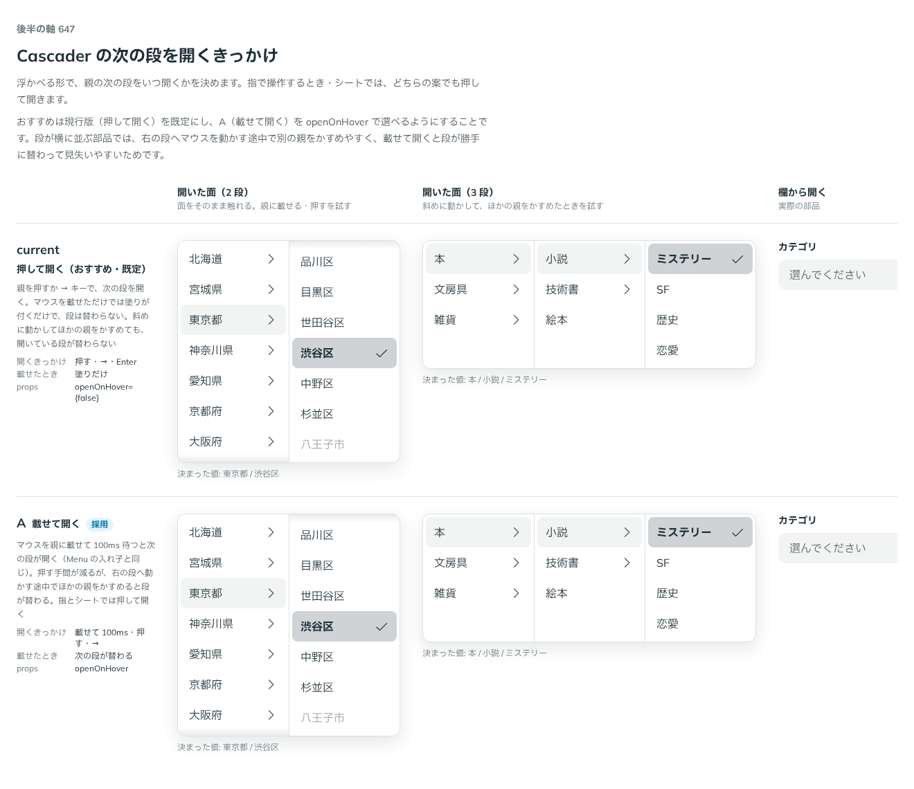
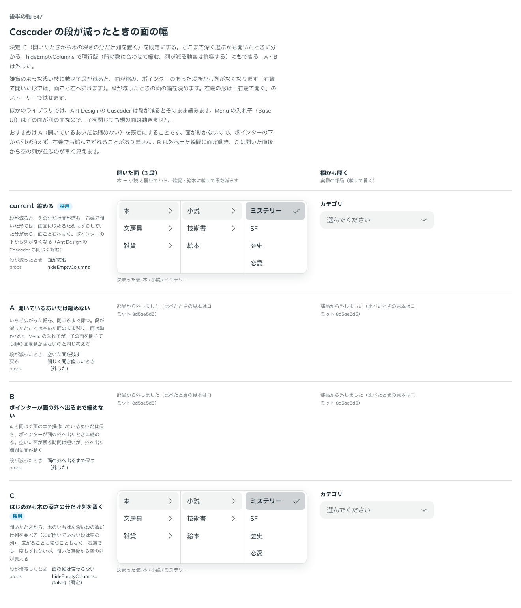

# 0519. Cascader は親に載せると次の段を開くのが既定。面は開いたときから木の深さの分の列を置く

- ステータス: Accepted
- 日付: 2026-10-16
- ラウンド: 後半 軸 647

## 背景

Cascader（浮かべる形）の、次の段を開くきっかけと、段が増減したときの面の幅を決める必要がありました。段は横に並ぶので、右の段へマウスを動かす途中で、別の親をかすめやすい構造です。

## 候補

開くきっかけ（指で操作するときとシートでは、どの案も押して開きます）。

| 案        | 開くきっかけ               | 載せたとき     |
| --------- | -------------------------- | -------------- |
| 現行版    | 押す・→・Enter             | 塗りだけ       |
| A（採用） | 載せて 100ms 待つ・押す・→ | 次の段が替わる |

段が減ったときの面の幅（雑貨のような浅い枝に載せて段が減る場面）。

| 案                                    | 段が増減したとき                                   |
| ------------------------------------- | -------------------------------------------------- |
| 現行版（縮める）                      | 面が縮む。右端では面ごと右へずれる                 |
| A（開いているあいだは縮めない）       | 閉じるまで、いちど広がった幅を保つ                 |
| B（ポインターが外へ出るまで縮めない） | 外へ出た瞬間に縮める                               |
| C（採用）                             | はじめから木の深さの分だけ列を置く。幅は変わらない |

## 決定

**親に載せると次の段を開く形（`openOnHover`）を既定にします。** マウスを親に載せて 100ms 待つと開きます（Menu の入れ子と同じ）。`openOnHover={false}` で、親を押すか → キーで開く形にもできます。

載せて開く形は、次の 2 つの誤動作を防ぎます。

- ポインターが実際に動いたときだけ数えます。開いた直後や、段が増えて面がずれた直後に、止まったポインターの下へ来た行では開きません
- 開いている次の段へ斜めに向かうあいだは、かすめた親では開きません（止まって 300ms で開きます）

面の幅は、**開いたときから木のいちばん深い段の数だけ列を置きます（`hideEmptyColumns` は既定 `false`）。** 段が増減しても幅は変わりません。`hideEmptyColumns` で、段の数に合わせて面が伸び縮みする形（列が減る動きは許容する）にもできます。

浮かべた面が上下に反転しないよう、開いた向きは閉じるまで固定し、上か下にだけ出します。

## 理由

ユーザーの返事の原文です。

> 647 A にしたいですが、右端で開いた時など、左に親が伸びていく場合に即座に選択されてしまう不具合ともとれる挙動があるので調整したいですね

> 647 雑貨 など一番左の列にして右が1列減ったときのレイアウトシフト（カーソルがあった箇所に列が無くなる）をどうするか考えたいですね…

> 647 については C が一番良さそうな気がしています。ユーザーが選ぶ最大の深さも認知できるので一石二鳥かもです。この挙動をデフォルトとして、オフにもできる（オフにした場合は列が減ることによる挙動などを許容する）とよさそうです。

> 「途中の段で決める を Docs で見ていたのですが、画面の下の方で開いていると、下向きに出てきたものにカーソルを当てる → 上向きに変わっちゃう」

最後の返事は、載せて開く形で、面の高さが変わって上下に反転する不具合の報告です。

以下は、決めたときの考えです。

- **Menu の入れ子と同じ動き**: 親に載せると開く形は、Menu の入れ子と同じです。マウスでは、押さずに段を行き来できます
- **誤選択を、ポインターの実際の動きで防ぐ**: 右端で開くと、段が増えるたびに面が左へずれ、止まっていたポインターの下へ別の親が来ます。ポインターが動いたときだけ数え、斜めの猶予を入れて直しました
- **列が消えるレイアウトシフトを、なくす**: 段が減ると、カーソルのあった場所から列がなくなります。はじめから深さの分の列を置けば、面は広がることも縮むこともなく、右端でも一度もずれません
- **深さが分かる**: 空の列が並ぶので、ユーザーはどこまで深く選ぶのかを、開いた時点で知れます
- **反転は閉じるまで固定**: 載せると次の段の高さで面の高さが変わります。向きを固定して、上下に跳ばないようにします（原則 14。内容が増えるときは跳ばずに滑らせる）

## 却下した案と理由

- **押して開く形を既定にすること**: 段が勝手に替わって見失うことはありませんが、段をたどるたびに押す手間が増えます。誤動作を直せば、載せて開く形のほうがマウスでは速く、Menu とも揃うため、`openOnHover={false}` で選べる形にしました
- **A（開いているあいだは縮めない）**: 面は動きませんが、段が減ったところに空いた面が残ります
- **B（ポインターが外へ出るまで縮めない）**: 外へ出た瞬間に面が動き、予測しにくいため、採りません
- **縮める形を既定にすること**: ポインターの下から列がなくなります。Ant Design の Cascader は縮めますが、`hideEmptyColumns` で選べる形に残しました

## 影響

- `src/components/cascader/Cascader.tsx`: `openOnHover`（既定 `true`）と `hideEmptyColumns`（既定 `false`）を持ちます
- 指で操作するときとシートでは、いつも押して開きます
- 比べたときの動く見本は、`c6f41152`（載せて開くかの比較）と `1567f21b`（面の幅の比較）にあります

## 原則への反映

原則 16 を書き換えました（開いた向きを閉じるまで変えない。ADR-0522 と同じ文）。

決めた時点のコミットは `1567f21b` です（右端の誤選択の直し `bc3784a0`、開いた向きの固定 `7b5efd2e`）。決めたコミットでは採らなかった案を部品から外していたため、上の 1 枚目の比較画像は、案がそろっていた `c6f41152` で撮りました。

## 比較画像

