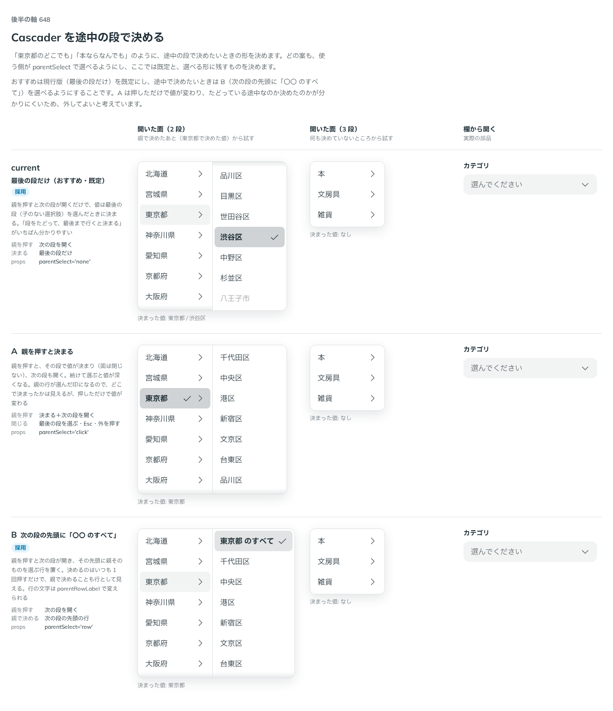

# 0520. Cascader は最後の段だけで決まるのが既定。parentSelect="row" で、次の段の先頭に「〇〇 のすべて」の行を置ける

- ステータス: Accepted
- 日付: 2026-10-16
- ラウンド: 後半 軸 648

## 背景

Cascader で、途中の段（親）で決められるかを決める必要がありました。「東京都のどこでも」「本ならなんでも」のように、親そのもので決めたい場面があります。どの案も、使う側が `parentSelect` で選べる形にし、ここでは既定と、選べる形に残すものを決めます。

## 候補

| 案                   | 親を押す                             | 決まる場所                      | `parentSelect` |
| -------------------- | ------------------------------------ | ------------------------------- | -------------- |
| 現行版（採用。既定） | 次の段を開くだけ                     | 最後の段だけ                    | `'none'`       |
| A                    | 決まる＋次の段を開く（面は閉じない） | 押した段・続けて選ぶと深くなる  | `'click'`      |
| B（選べる形に採用）  | 次の段を開くだけ                     | 次の段の先頭の「〇〇 のすべて」 | `'row'`        |

## 決定

**最後の段だけで決まる形（`parentSelect="none"`）を既定にします。** 親を押すと次の段が開くだけで、値は最後の段（子のない選択肢）を選んだときに決まります。

親で決められるようにするときは、**B（`parentSelect="row"`）にします。** 親を押すと次の段が開き、その先頭に、親そのものを選ぶ行（「東京都 のすべて」）を置きます。行の文字は `parentRowLabel` で変えられます。

## 理由

ユーザーの返事の原文です。

> 648 親を選択できるようにする場合は B の挙動で、そうでないときは現行としたいです。

以下は、決めたときの考えです。

- **段をたどって、最後まで行くと決まる**: Cascader は、段ごとに順に答える道筋です。道筋の終わりが「ここまで」と分かるのが、いちばん分かりやすい形です
- **親で決めるときは、行として見える**: 次の段の先頭に行を置くと、決めるのはいつも 1 回押すだけです。親で決めることも、行として目に見えます
- **TreeSelect とは考え方が違う**: Cascader の値は道筋なので、途中で止まる道筋を示す特別な行が要ります。TreeSelect の値は点で、親もほかの行と同じ点にできます（ADR-0517）

## 却下した案と理由

- **A（親を押すと決まる）**: 押しただけで値が変わり、たどっている途中なのか、決めたのかが分かりにくいため、採りません。部品の選べる形からも外しました（比べたときの見本はコミット `c6f41152`）

## 影響

- `src/components/cascader/Cascader.tsx`: `parentSelect`（`'none'`・`'row'`、既定 `'none'`）と `parentRowLabel`（既定「`{名前} のすべて`」）を持ちます
- `'click'` は持ちません

## 原則への反映

反映なし。

決めた時点のコミットは `bc3784a0` です。決めたコミットでは採らなかった案を部品から外していたため、上の 1 枚目の比較画像は、案がそろっていた `c6f41152` で撮りました。

## 比較画像

