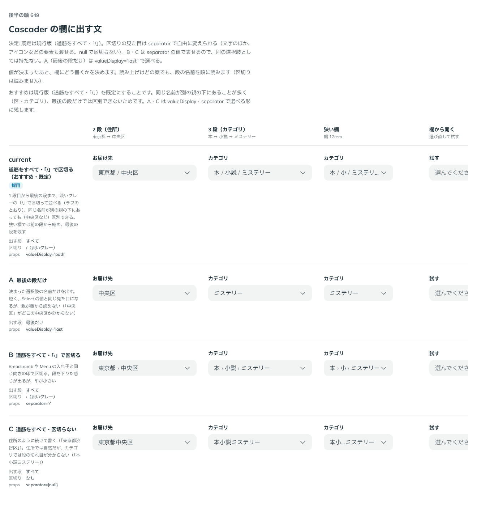

# 0521. Cascader は欄に道筋を「/」で区切って出すのが既定。valueDisplay・separator・renderValue で変えられる

- ステータス: Accepted
- 日付: 2026-10-16
- ラウンド: 後半 軸 649

## 背景

Cascader の欄に、選んだ値をどう出すかを決める必要がありました。値は段ごとの道筋です。住所のように親が値の意味に入るものと、カテゴリのように段の切れ目が大切なものがあります。

## 候補

| 案             | 出す段   | 区切り             | props                 |
| -------------- | -------- | ------------------ | --------------------- |
| 現行版（採用） | すべて   | 淡いグレーの「/」  | `valueDisplay="path"` |
| A              | 最後だけ | なし               | `valueDisplay="last"` |
| B              | すべて   | 淡いグレーの「›」  | `separator="›"`       |
| C              | すべて   | なし（続けて書く） | `separator={null}`    |

## 決定

**1 段目から最後の段までをすべて、淡いグレーの「/」で区切って出す形（`valueDisplay="path"`）を既定にします。** 狭い欄では前の段から縮め、最後の段を残します。

区切りは `separator` で変えられ、文字のほか、アイコンも渡せます。`null` では区切らずに続けて書きます。最後の段だけにするときは `valueDisplay="last"` です。中身をすべて差し替えるときは `renderValue` を渡します。

## 理由

ユーザーの返事の原文です。

> 649 デフォルトは現行版として、区切りの見た目を任意設定できるとよさそう。644 関連ですね

以下は、決めたときの考えです。

- **道筋が値の意味に入る**: 同じ名前が別の親の下にあっても（中央区など）区別できます。親が欄から読めます
- **区切りは場面で変わる**: 住所は続けて書くと自然ですが、カテゴリでは段の切れ目が分からなくなります（「本小説ミステリー」）。どれが合うかは使う側の場面で決まるので、部品は決め切りません（原則 20）
- **TreeSelect と同じ名前と型**: 区切りの `separator`・差し替えの `renderValue` は、TreeSelect の複数選ぶ形（ADR-0516）と揃えます

## 却下した案と理由

- **A（最後の段だけ）を既定にすること**: 短く Select の値と同じ見た目ですが、親が欄から読めません。`valueDisplay="last"` で選べる形に残しました
- **B（「›」で区切る）・C（区切らない）を専用の案として持つこと**: `separator` に値を渡せば描けるため、専用の props は持ちません

## 影響

- `src/components/cascader/Cascader.tsx`: `valueDisplay`（`'path'`・`'last'`、既定 `'path'`）・`separator`（既定 `'/'`、`null` で区切らない）・`renderValue` を持ちます
- 区切りは、読み上げでは読みません

## 原則への反映

反映なし。原則 20 の範囲内です。

決めた時点のコミットは `75d83bac` です。

## 比較画像

