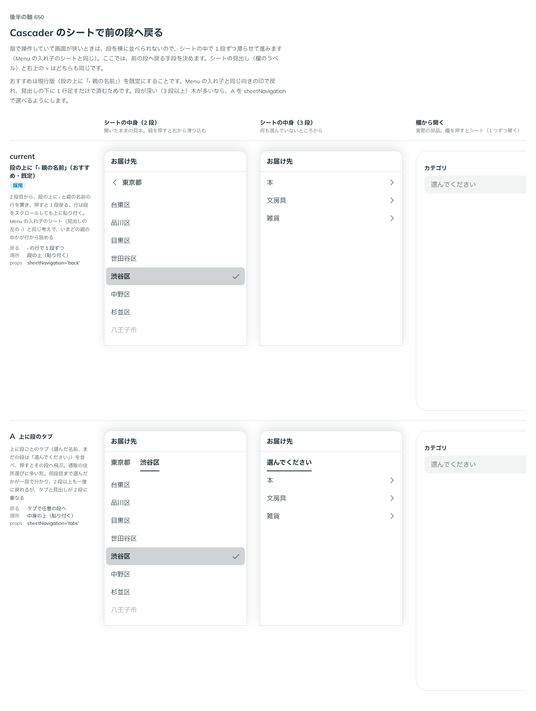
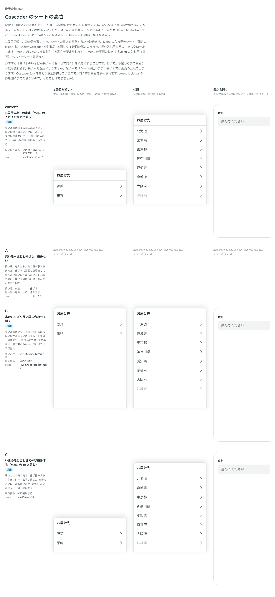

# 0522. Cascader のシートは「‹ 親の名前」の行で前の段へ戻り、高さは木のいちばん長い段に合わせるのが既定

- ステータス: Accepted
- 日付: 2026-10-16
- ラウンド: 後半 軸 650

## 背景

指で操作していて画面が狭いとき、Cascader は段を横に並べられないので、シートの中で 1 段ずつ滑らせて進みます（Menu の入れ子のシートと同じ。原則 16）。ここでは、前の段へ戻る手段と、シートの高さを決める必要がありました。

## 候補

前の段へ戻る手段。

| 案             | 戻る                          | 場所                 |
| -------------- | ----------------------------- | -------------------- |
| 現行版（採用） | 「‹ 親の名前」の行で 1 段ずつ | 段の上（貼り付く）   |
| A              | 段のタブで任意の段へ          | 中身の上（貼り付く） |

シートの高さ。

| 案                                  | 段を移るとき                                 | `levelSheet` |
| ----------------------------------- | -------------------------------------------- | ------------ |
| 現行版（Menu の入れ子の既定と同じ） | 1 段目の高さのまま。長い段は中でスクロール   | `'fixed'`    |
| A                                   | 長い段へ進むと伸ばし、縮めない               | （外した）   |
| B（採用）                           | 木のいちばん長い段に合わせて開く。変わらない | `'tallest'`  |
| C（Menu の `fit` と同じ）           | いまの段に合わせて伸び縮みする               | `'fit'`      |

## 決定

**前の段へは、段の上の「‹ 親の名前」の行で戻ります。** 2 段目から、段をスクロールしても上に貼り付く行を置き、押すと 1 段戻ります。Menu の入れ子のシート（見出しの左の ‹）と同じ考えで、いまどの親の中かが行から読めます。タブ（A）は採りません。

**シートの高さは、B（開いたときから木のいちばん長い段に合わせる）を既定にします。** 段を進んでも戻っても高さは一度も変わらず、短い段では下が空きます。画面の上限で止まります。`levelSheet` で、現行版（`'fixed'`。Menu の `submenuSheet="fixed"` と同じ）と C（`'fit'`。Menu の `submenuSheet="fit"` と同じ）も選べます。

浮かべる形の面も、列の高さを最長の段にそろえます。下に収まらないときは、広い方に開きます。

## 理由

ユーザーの返事の原文です。

> 650 現行版でよさそう。高さの挙動を Menu のときと揃えたいですね。

> Cascader については Select や Menu に揃えるで良さそう。

> 650 ちょっと挙動が違う気がしてます、最初が一番少なくて後から選択肢が増えたときに違和感があるんですが、Menu も同じ挙動になっていますか？

Menu の入れ子のシートも、1 段目の高さのまま（`fixed`）で、長い入れ子はその中でスクロールします。同じ挙動だと答えました。

> 650 B にしたいですね。Cascader については、深まるにつれて内容が増えることが容易に想定できるので、他の選択肢ではレイアウトシフトが多くなりそう。Menu と同じ挙動にできるのがいいかも？と思うので、現行（Menu のデフォルト）と C（Menu の fit）も選べると良さそう。Menu に B の挙動を足す方針については、backlog で未決事項として足してもらえますか？

> 高さは揃えるにしたいですね。そもそも自動判定なのであれば、初めからより広い方に開くのがいいのかもしれませんね。

以下は、決めたときの考えです。

- **戻る手段は、Menu と同じ ‹**: 同じ向きの印で戻れ、見出しの下に 1 行足すだけで済みます。いまの親の名前が行に出るので、どこにいるか分かります
- **深い段ほど選択肢が増える**: Cascader は、深まるほど内容が増えることが多く、1 段目の高さのままだと長い段が窮屈になります。段ごとに伸び縮みする形では、移るたびにシートの上端が動きます。開いたときから最長の段に合わせれば、移っても高さが変わらず、レイアウトシフトがありません（原則 14）
- **Menu と同じ動きも選べる**: Menu の `fixed`・`fit` と同じ名前で選べるようにし、場所によって揃えられます
- **浮かべる面も最長の段に**: 向きは自動で決まるので、開いたあとに面の高さが変わると、向きが合わなくなります。列の高さを最長の段にそろえ、下に収まらないときは最初から広い方に開きます

## 却下した案と理由

- **A（上に段のタブ）**: 2 段以上も一度に戻れますが、タブと見出しが 2 段に重なります。`sheetNavigation` ごと外しました（比べたときの見本はコミット `c6f41152`）
- **長い段へ進むと伸ばし、縮めない**: 伸びるのは 1 回だけですが、進んだときにシートが動きます。部品から外しました（比べたときの見本はコミット `1567f21b`）
- **1 段目の高さのまま（`fixed`）を既定にすること**: 1 段目が短く次の段が長い木で、長い段が狭い中に押し込まれます。`levelSheet="fixed"` で選べる形に残しました

## 影響

- `src/components/cascader/Cascader.tsx`: `levelSheet`（`'tallest'`・`'fixed'`・`'fit'`、既定 `'tallest'`）と `backName`（戻る行の読み上げの補足、既定「戻る」）を持ちます
- Menu の入れ子のシートに、B の「いちばん長い段に合わせる」形を足すかは未決です（backlog）

## 原則への反映

原則 16 を書き換えました。段をたどる面の高さはいちばん長い段に合わせ、段を移っても高さと開いた向きを変えない、という文を足しました。

決めた時点のコミットは `796f83d6` です（浮かべる面も最長段の高さにする `7b5efd2e`）。決めたコミットでは採らなかった案を部品から外していたため、上の 1 枚目の比較画像は、案がそろっていた `c6f41152` で撮りました。

## 比較画像

