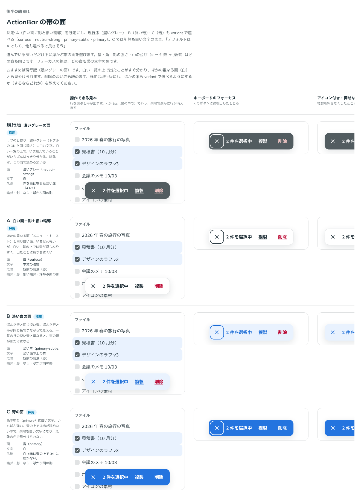

# 0523. ActionBar の帯は、白い面に影と細い輪郭が既定。variant で濃いグレー・淡い青・青も選べる

- ステータス: Accepted
- 日付: 2026-10-16
- ラウンド: 後半 軸 651

## 背景

ActionBar（一覧で行を選ぶと下に浮かぶ、件数と操作の帯）の面を決める必要がありました。ラフは濃いグレーの面でした。

## 候補

| 案        | 面            | 文字           | 危険の操作                        | 輪郭・影               |
| --------- | ------------- | -------------- | --------------------------------- | ---------------------- |
| 現行版    | 濃いグレー    | 白             | 赤を白に寄せた淡い赤（4.6:1）     | なし・浮かぶ面の影     |
| A（採用） | 白            | 本文の濃紺     | 危険の前景（赤）                  | 細い輪郭・浮かぶ面の影 |
| B         | 淡い青        | 淡い面の上の青 | 危険の前景（赤）                  | なし・浮かぶ面の影     |
| C         | 青（primary） | 白             | 白（赤は青の上で 3:1 に届かない） | なし・浮かぶ面の影     |

## 決定

**A（白い面に影と細い輪郭）を既定にします。** `variant` で、現行版（`'neutral-strong'`）・B（`'primary-subtle'`）・C（`'primary'`）も選べます（既定は `'surface'`）。C は青の上で赤が読めないので、`status="danger"` の操作も白い文字のままです。

## 理由

ユーザーの返事の原文です。

> 651 デフォルトは A として、他も選べると良さそう

以下は、決めたときの考えです。

- **重なる面と同じ**: A はメニューやトーストと同じ白い面です。ページの上に重なる面は、やわらかく広い影と細い輪郭で下と切り分けます（原則 1）
- **危険の色が使える**: 白い面なら、削除は危険の前景（赤）でそのまま読めます。濃いグレーや青の上では、赤を淡くしたり白にしたりする調整が要ります
- **ほかの面は場面で選ぶ**: 白い一覧の上で、いま選んでいることをはっきり見せたい画面もあります。面の色は部品が決め切らず、選べる形にします（原則 20）

## 却下した案と理由

- **現行版（濃いグレー）を既定にすること**: 白い一覧の上でいちばんはっきりしますが、強い面が画面の下に出続けます。`variant="neutral-strong"` で選べる形に残しました
- **B（淡い青）を既定にすること**: 選んだ行と同じ色でつながって見えますが、一覧の行の淡い青と重なると、帯の縁が影だけになります。選べる形に残しました
- **C（青）を既定にすること**: いちばん強く、削除が危険の色で見分けられません。選べる形に残しました

## 影響

- `src/components/action-bar/ActionBar.tsx`: `variant`（`'surface'`・`'neutral-strong'`・`'primary-subtle'`・`'primary'`、既定 `'surface'`）を持ちます

## 原則への反映

反映なし。原則 1 の範囲内です。

決めた時点のコミットは `785c81da` です。

## 比較画像

