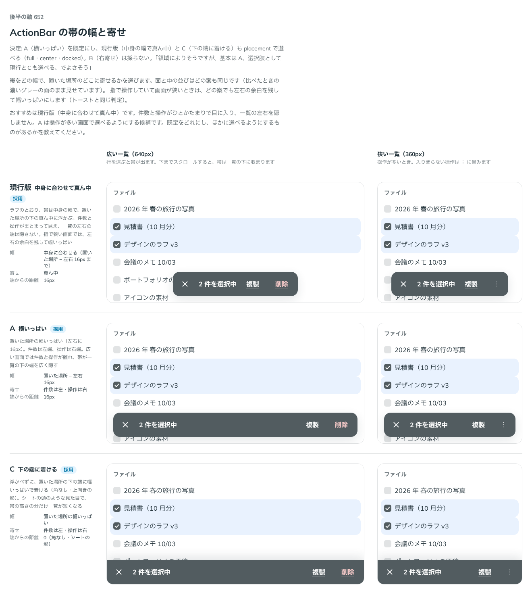

# 0524. ActionBar の帯は、置いた場所の幅いっぱいが既定。placement で中身の幅の真ん中、下の端に着ける形も選べる

- ステータス: Accepted
- 日付: 2026-10-16
- ラウンド: 後半 軸 652

## 背景

ActionBar の帯の幅と、置いた場所のどこに寄せるかを決める必要がありました。面と中の並びはどの案も同じです。指で操作していて画面が狭いときは、どの案でも左右の余白を残して幅いっぱいにします（トーストと同じ判定）。

## 候補

| 案        | 幅                                            | 寄せ               | 端からの距離 |
| --------- | --------------------------------------------- | ------------------ | ------------ |
| 現行版    | 中身に合わせる（置いた場所 − 左右 16px まで） | 真ん中             | 16px         |
| A（採用） | 置いた場所 − 左右 16px                        | 件数は左・操作は右 | 16px         |
| C         | 置いた場所の幅いっぱい                        | 件数は左・操作は右 | 0（角なし）  |

B（右寄せ）は、比べる前に外しました。

## 決定

**A（置いた場所の幅いっぱいに、件数を左・操作を右に置く）を既定にします。** `placement` で、現行版（`'center'`。中身の幅で真ん中に浮かべる）と C（`'docked'`。浮かべずに、置いた場所の下の端へ幅いっぱいで着ける）も選べます（既定は `'full'`）。

`docked` の輪郭は、上の線だけにします。左右と下は置いた場所の端に着くので、線を引きません。角も付けません。

## 理由

ユーザーの返事の原文です。

> 652 領域によりそうですが、基本は A、選択肢として現行とCも選べる、でよさそう

> 1: 上の線だけで。（ActionBar docked の輪郭）
> 2: よさそう。（placement の値 full・center・docked）

以下は、決めたときの考えです。

- **置かれる場所の幅は部品には分からない**: 一覧の幅や余白は、置く側の画面で変わります。幅いっぱいを既定にし、中身の幅に寄せるか、下の端に着けるかは使う側が選びます（原則 20）
- **件数と操作が離れても読める**: 件数は左端、操作は右端にあるので、置く場所の端をそろえて読めます。操作が増えても、帯の形は変わりません
- **docked は上の線だけで足りる**: 下の端に着けた帯は、一覧との境目だけが見えれば、帯と分かります

## 却下した案と理由

- **現行版（中身に合わせて真ん中）を既定にすること**: 件数と操作がひとかたまりで目に入りますが、操作が多い画面で帯が入りきらず、畳みやすくなります。`placement="center"` で選べる形に残しました
- **C（下の端に着ける）を既定にすること**: シートの頭のような見た目で、帯の高さの分だけ一覧が短くなります。選べる形に残しました
- **B（右寄せ）**: 件数と操作がまとまって見えず、採りません

## 影響

- `src/components/action-bar/ActionBar.tsx`: `placement`（`'full'`・`'center'`・`'docked'`、既定 `'full'`）を持ちます
- 帯の重なりの順は、貼り付けた Navbar と同じ `z-10` にし、`⋮` のメニューとシートが帯の上に出るようにしました（ADR-0526）

## 原則への反映

反映なし。原則 20 の範囲内です。

決めた時点のコミットは `578c475a` です（docked の上の線 `01fc4866`）。

## 比較画像

