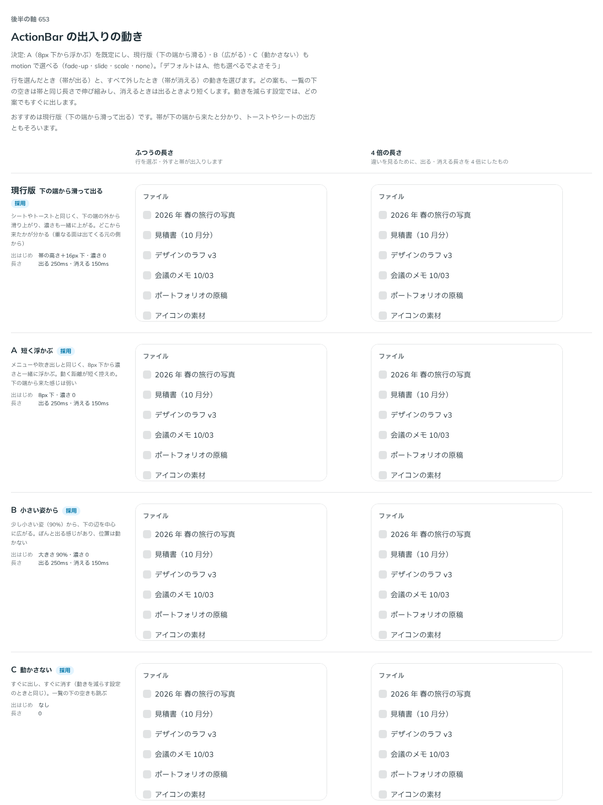

# 0525. ActionBar は 8px 下から浮かんで出るのが既定。motion で下の端から滑る形・広がる形・動かさない形も選べる

- ステータス: Accepted
- 日付: 2026-10-16
- ラウンド: 後半 軸 653

## 背景

行を選んだとき（帯が出る）と、すべて外したとき（帯が消える）の動きを決める必要がありました。どの案も、一覧の下の空きは帯と同じ長さで伸び縮みし、消えるときは出るときより短くします（出る 250ms・消える 150ms）。動きを減らす設定では、どの案でもすぐに出します。

## 候補

| 案        | 出はじめ                  | 感じ                                           |
| --------- | ------------------------- | ---------------------------------------------- |
| 現行版    | 帯の高さ＋16px 下・濃さ 0 | 下の端の外から滑り上がる。どこから来たか分かる |
| A（採用） | 8px 下・濃さ 0            | メニューや吹き出しと同じ。控えめ               |
| B         | 大きさ 90%・濃さ 0        | 下の辺を中心に広がる。ぽんと出る               |
| C         | なし                      | すぐに出し、すぐに消す。一覧の下の空きも跳ぶ   |

## 決定

**A（8px 下から濃さと一緒に浮かぶ）を既定にします。** `motion` で、現行版（`'slide'`。下の端の外から滑って出る）・B（`'scale'`）・C（`'none'`）も選べます（既定は `'fade-up'`）。

## 理由

ユーザーの返事の原文です。

> 653 デフォルトはA、他も選べるでよさそう

以下は、決めたときの考えです。

- **重なる面の出方に揃う**: メニューや吹き出しと同じ出方です。ページの上に重なる面が、出てくる元の側から短く出る考え方に沿います（原則 14）
- **動きが短く控えめ**: 行を選ぶたびに出入りする帯なので、動く距離が短いほうが、選ぶ操作の邪魔になりません
- **ほかは場面で選ぶ**: 下の端から来たと見せたい画面や、動きをなくしたい画面もあります。選べる形に残します

## 却下した案と理由

- **現行版（下の端から滑る）を既定にすること**: どこから来たかは分かりますが、動く距離が長く、行を選ぶたびに目立ちます。`motion="slide"` で選べる形に残しました
- **B（小さい姿から広がる）を既定にすること**: ぽんと出る手応えはありますが、帯の幅が変わって見えます。選べる形に残しました
- **C（動かさない）を既定にすること**: 一覧の下の空きが跳びます。動きを減らす設定のときと同じ挙動は、`motion="none"` で選べます

## 影響

- `src/components/action-bar/ActionBar.tsx`: `motion`（`'fade-up'`・`'slide'`・`'scale'`・`'none'`、既定 `'fade-up'`）を持ちます

## 原則への反映

反映なし。原則 14 の範囲内です。

決めた時点のコミットは `6488f30f` です。

## 比較画像

