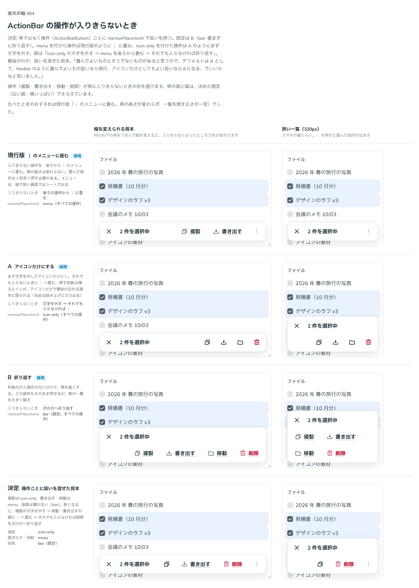

# 0526. ActionBar の操作は、入りきらないと折り返すのが既定。操作ごとに narrowPlacement で ⋮ への畳みやアイコンだけにもできる

- ステータス: Accepted
- 日付: 2026-10-16
- ラウンド: 後半 軸 654

## 背景

操作（複製・書き出す・移動・削除）が帯に入りきらないときの形を決める必要がありました。帯の面と幅は、決めた既定（白い面・幅いっぱい。ADR-0523・0524）でそろえて比べました。

## 候補

| 案         | 入りきらないとき                                                     | 値            |
| ---------- | -------------------------------------------------------------------- | ------------- |
| 現行版     | 後ろから ⋮ のメニューに畳む。帯の高さは変わらない                    | `'menu'`      |
| A          | まず文字を外してアイコンだけ、それでも入らなければ ⋮ へ              | `'icon-only'` |
| B          | 次の行へ折り返す。帯が高くなる                                       | `'bar'`       |
| 決定の見本 | 複製は `icon-only`、書き出す・移動は `menu`、削除は書かない（`bar`） | 操作ごと      |

## 決定

**帯ではなく操作（`ActionBarButton`）ごとに、入りきらないときの扱い（`narrowPlacement`）を持ちます。既定は B（`'bar'`。畳まずに折り返す）です。**

- `menu` を付けた操作は、現行版のように `⋮` のメニューに畳みます
- `icon-only` を付けた操作は、A のようにまず文字を外してアイコンだけにします

狭くなったときの順は、次のとおりです。

1. `icon-only` の操作の文字を外す
2. `menu` の操作を後ろから `⋮` に畳む
3. それでも入らなければ、`bar` の操作を次の行へ折り返す

## 理由

ユーザーの返事の原文です。

> 654 畳んでよいものとそうでないものがあると思うので、デフォルトは B として、Navbar のように畳んでよいもの扱いなら現行、アイコンだけにしてもよい扱いならAになる、でいいかなと思いました。

> 654 Menu より ActionBar の方が上にあるので、決定/狭い一覧 だとメニューが選べないですね。あとは、そもそもメニューを指で開くとシートになりますかね？

2 つ目の返事への答えです。帯の重なりの順を `z-30` から `z-10`（貼り付けた Navbar と同じ）に下げ、`⋮` のメニューとシートが帯の上に出るようにしました。指で操作していて画面が狭いときは、メニューはシートで出ます（原則 16）。

以下は、決めたときの考えです。

- **畳んでよいかは、操作で違う**: 削除のように、いつでも見えていてほしい操作もあります。部品は、どれを畳んでよいかを知らないので、操作ごとに使う側が決めます（原則 20）
- **既定は畳まない**: 畳むと、操作を 1 回多く押す必要があります。何も書かなければ、どの操作もそのまま押せる形を既定にします
- **Navbar と同じ考え方**: Navbar は、並べきれない行き先を畳みます（原則 16）。ActionBar でも、畳んでよい操作は `menu` にします

## 却下した案と理由

- **帯全体で 1 つの扱いにすること（現行版・A・B の 1 つを帯の props にする）**: 畳んでよい操作と、そうでない操作が混ざる帯では、どれを選んでも合いません。操作ごとの `narrowPlacement` にしました
- **現行版（⋮ に畳む）を既定にすること**: 帯の高さが変わらず一覧を隠す広さが一定ですが、畳んだ操作は 1 回多く押す必要があります。比べたときのおすすめでしたが、操作ごとに選べる形にしました

## 影響

- `src/components/action-bar/ActionBar.tsx`: `ActionBarButton` が `narrowPlacement`（`'bar'`・`'icon-only'`・`'menu'`、既定 `'bar'`）を持ちます。畳んだ操作を開く `⋮` の読み上げの名前は `moreName`（既定「その他の操作」）で変えられます
- 帯の重なりの順を `z-10` にしました（ADR-0524 と同じ変更）

## 原則への反映

反映なし。原則 16 と原則 20 の範囲内です。

決めた時点のコミットは `48bf0f25` です（メニューの重なり `01fc4866`）。

## 比較画像

