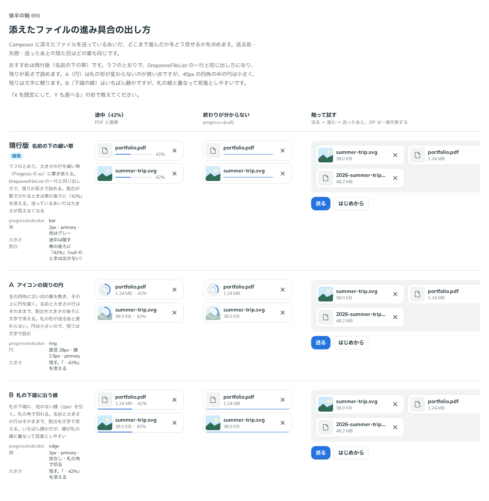

# 0527. Attachment の進み具合は、名前の下の細い帯が既定。割合を文字でも添え、円と下端の線も選べる

- ステータス: Accepted
- 日付: 2026-10-16
- ラウンド: 後半 軸 655

## 背景

Attachment（添えたファイルの札）で、送っているあいだの進み具合の出し方を決める必要がありました。割合が分かるとき（`progress` が数）と、終わりが分からないとき（`progress={null}`）があります。

## 候補

| 案             | 出し方                                  | 大きさの行 | 割合の文字              |
| -------------- | --------------------------------------- | ---------- | ----------------------- |
| 現行版（採用） | 名前の下の細い帯（Progress の xs。2px） | 途中は隠す | 帯の後ろに「42%」       |
| A              | 左の四角に淡い幕を敷き、その上に円      | 残す       | 大きさの後ろに「・42%」 |
| B              | 札の下端に沿う地のない線（2px）         | 残す       | 大きさの後ろに「・42%」 |

## 決定

**現行版（名前の下の細い帯）を既定にします。** `progressIndicator` で、A（`'ring'`。左の四角を囲む円）・B（`'edge'`。札の下端に沿う線）も選べます（既定は `'bar'`）。どの出し方でも、`progress` が数のときは割合を文字でも添えます（`null` のときは出しません）。

## 理由

ユーザーの返事の原文です。

> 655 デフォルトは現行、他も選べる、がよさそう。現行でも progress が提供されているならパーセントを表示したいです

以下は、決めたときの考えです。

- **残りが長さで読める**: 帯は、残りが長さで分かります。円は小さく、残りは文字で読むことになります
- **ほかの一覧と同じ出し方**: DropzoneFileList の一行と同じ出し方です。同じ画面に並んでも、進み具合の見え方が揃います
- **割合は数でも読める**: 帯だけでは、あと何割かを読み取りにくいため、割合が分かるときは文字でも添えます
- **場面で選べる**: 札の形を送る前と変えたくない画面では円、静かにしたい画面では下端の線を選びます

## 却下した案と理由

- **A（円）を既定にすること**: 札の形が送る前と変わりませんが、円は小さく、残りを文字で読むことになります。選べる形に残しました
- **B（下端の線）を既定にすること**: いちばん静かですが、線が札の線に重なり、見落としやすくなります。選べる形に残しました

## 影響

- `src/components/attachment/Attachment.tsx`: `progressIndicator`（`'bar'`・`'ring'`・`'edge'`、既定 `'bar'`）を持ちます
- 帯では、送っているあいだ、大きさの行を隠します（途中は割合が代わりに出ます）

## 原則への反映

反映なし。

決めた時点のコミットは `84c25687` です。

## 比較画像

