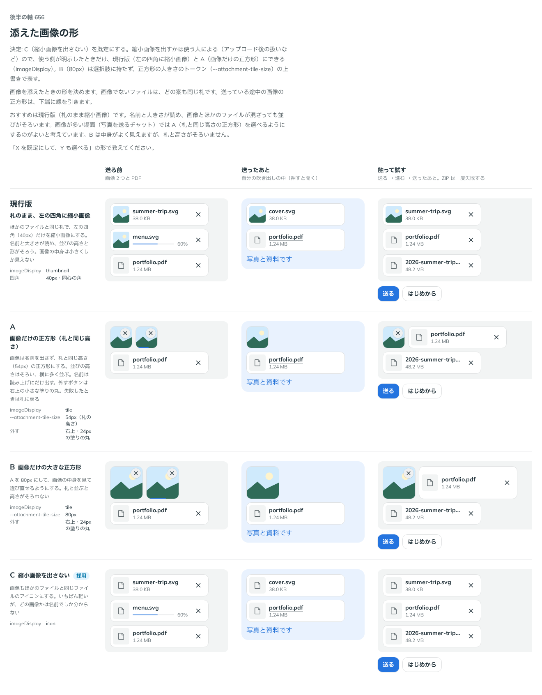

# 0528. Attachment の画像は、縮小画像を出さないのが既定。imageDisplay で縮小画像と正方形を選べる

- ステータス: Accepted
- 日付: 2026-10-16
- ラウンド: 後半 軸 656

## 背景

画像を添えたときの札の形を決める必要がありました。画像でないファイルは、どの案も同じ札です。送っている途中の画像の正方形は、下端に線を引きます。

## 候補

| 案        | 形                                                              | `imageDisplay`     |
| --------- | --------------------------------------------------------------- | ------------------ |
| 現行版    | 札のまま、左の四角（40px）に縮小画像                            | `'thumbnail'`      |
| A         | 画像だけの正方形（札と同じ高さ 54px）。名前は読み上げにだけ出す | `'tile'`           |
| B         | A を 80px にした大きな正方形                                    | `'tile'`＋トークン |
| C（採用） | 縮小画像を出さず、ほかのファイルと同じアイコン                  | `'icon'`           |

## 決定

**C（縮小画像を出さない。ほかのファイルと同じアイコン）を既定にします。** 縮小画像を見せたいときは、使う側が明示して `imageDisplay` で選びます。現行版は `'thumbnail'`、A は `'tile'` です（失敗したときは札に戻ります）。

B（80px）は選べる形に持たず、正方形の大きさのトークン（`--attachment-tile-size`）を上書きして表します。

## 理由

ユーザーの返事の原文です。

> 656 ファイルプレビューを表示させたいかはユーザーに寄りそう（アップロード後の扱いなどが問題になるため。）なので、デフォルトでは C としておき、ユーザーから明示的に指定された場合のみ、現行・A の形にできる、がよさそう

以下は、決めたときの考えです。

- **縮小画像を出すかは、部品には分からない**: 縮小画像を出すと、選んだ画像を画面に読み込みます。アップロード後の扱いなども、使う側のサービスで決まります。部品は決め切らず、使う側が明示したときだけ出します（原則 20）
- **画像とほかのファイルの並びがそろう**: 既定のアイコンなら、混ざっても札の高さと形が同じです

## 却下した案と理由

- **現行版（左の四角に縮小画像）を既定にすること**: 名前と大きさが読め並びもそろいますが、画像を読み込む判断を部品が先に決めてしまうため、明示したときだけにしました
- **A（画像だけの正方形）を既定にすること**: 画像が多い場面（写真を送るチャット）に向きますが、名前が見えず、並びの高さの違いも出ます。選べる形に残しました
- **B（80px の大きな正方形）を選べる形に持つこと**: 大きさの違いだけなので、トークンの上書きで表します

## 影響

- `src/components/attachment/Attachment.tsx`: `imageDisplay`（`'icon'`・`'thumbnail'`・`'tile'`、既定 `'icon'`）を持ちます
- `--attachment-tile-size`（`attachment.tokens.css`）で正方形の大きさを変えられます

## 原則への反映

反映なし。原則 20 の範囲内です。

決めた時点のコミットは `30b505fe` です。

## 比較画像

