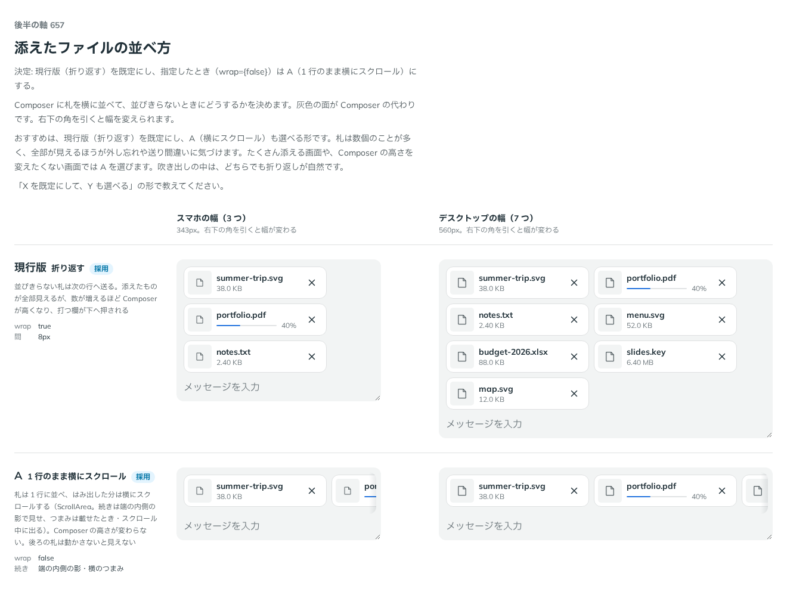

# 0529. AttachmentList は折り返すのが既定。wrap={false} で 1 行のまま横にスクロールできる

- ステータス: Accepted
- 日付: 2026-10-16
- ラウンド: 後半 軸 657

## 背景

Composer に札を横に並べたとき、並びきらない分をどうするかを決める必要がありました。

## 候補

| 案             | 並びきらないとき                                                                                       | `wrap`  |
| -------------- | ------------------------------------------------------------------------------------------------------ | ------- |
| 現行版（採用） | 次の行へ送る。添えたものが全部見える。数が増えるほど Composer が高くなる                               | `true`  |
| A              | 1 行のまま横にスクロールする（ScrollArea。続きは端の内側の影、つまみは載せたとき・スクロール中に出る） | `false` |

## 決定

**現行版（折り返す）を既定にします。** 指定したとき（`wrap={false}`）は A（1 行のまま横にスクロール）にします。

## 理由

ユーザーの返事の原文です。

> 657 デフォルトは折り返す、指定されたらスクロール、で。

以下は、決めたときの考えです。

- **全部が見える**: 札は数個のことが多く、全部が見えるほうが、外し忘れや送り間違いに気づけます
- **高さを変えたくない場面は使う側が選ぶ**: たくさん添える画面や、Composer の高さを変えたくない画面では、使う側が `wrap={false}` にします。部品は、置かれる場所の高さを知りません（原則 20）
- **送ったあとの吹き出しの中は折り返しが自然**: どちらでも、折り返しが読みやすい場所です

## 却下した案と理由

- **A（横にスクロール）を既定にすること**: Composer の高さが変わりませんが、後ろの札は動かさないと見えません。`wrap={false}` で選べる形に残しました

## 影響

- `src/components/attachment/AttachmentList.tsx`: `wrap`（既定 `true`）を持ちます
- 名前は、`direction` の折り返しの `wrap`（`design/props.md`）に揃えました

## 原則への反映

反映なし。原則 20 の範囲内です。

決めた時点のコミットは `29ebfa63` です。

## 比較画像

