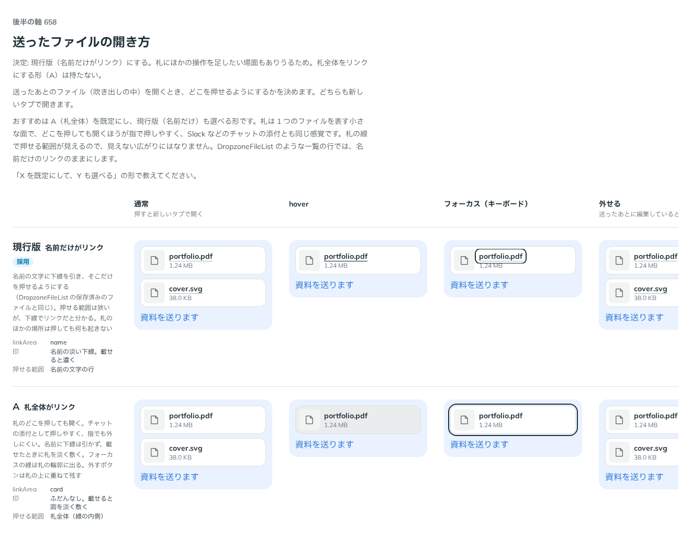

# 0530. Attachment は、名前だけがリンクが既定。画像だけの正方形（tile）は全体をリンクにする

- ステータス: Accepted
- 日付: 2026-10-16
- ラウンド: 後半 軸 658

## 背景

送ったあとのファイル（吹き出しの中）を開くとき、札のどこを押せるようにするかを決める必要がありました。どちらも新しいタブで開きます。

## 候補

| 案             | 押せる範囲     | 印                               |
| -------------- | -------------- | -------------------------------- |
| 現行版（採用） | 名前の文字の行 | 名前の淡い下線。載せると濃く     |
| A              | 札全体         | ふだんなし。載せると面を淡く敷く |

## 決定

**名前だけをリンクにします。** 名前の文字に下線を引き、そこだけを押せるようにします（DropzoneFileList の保存済みのファイルと同じ）。札のほかの場所は、押しても何も起きません。札全体をリンクにする形（A）は持ちません。

**例外は、画像だけの正方形（`imageDisplay="tile"`）です。** 名前の文字がないので、正方形いっぱいをリンクにします。

## 理由

ユーザーの返事の原文です。

> 658 札にオプションを足したいケースが無いとも言えなさそう、なので現行にします。

> 3: tile は例外で良さそう。（Attachment tile は全体リンク）

以下は、決めたときの考えです。

- **札にほかの操作を足せる**: 札全体をリンクにすると、札の中に操作（外す・もう一度送るなど）を足すときに、リンクの中にボタンが入る形になります。文字だけをリンクにすれば、札は自由に足せます
- **押せる範囲は文字の行だけ**: 文字のリンクの押せる範囲は、文字の行だけです（原則 17）。下線でリンクだと分かります
- **tile は文字がない**: 名前の文字がない正方形では、押せる範囲を見た目の範囲（正方形）と一致させます（原則 17）。フォーカスの線は正方形の輪郭に出します

## 却下した案と理由

- **A（札全体がリンク）**: チャットの添付として押しやすく、指でも外しにくい利点があります。一方、見えない広がりはなくても、札に足す操作と重なります。持たないことにしました（`linkArea` の props も外しました）

## 影響

- `src/components/attachment/Attachment.tsx`: `url` を渡すと、名前の文字が新しいタブで開くリンクになります
- `linkArea` は持ちません
- tile の画像は、`url` を渡すと正方形いっぱいのリンクになります（名前は読み上げにだけ出します）

## 原則への反映

原則 17 を書き換えました。文字のない画像だけのリンクは、画像の範囲全体を押せる範囲にする、という文を足しました。

決めた時点のコミットは `c9840c4a` です（tile の全体リンク `7c34c638`）。

## 比較画像

