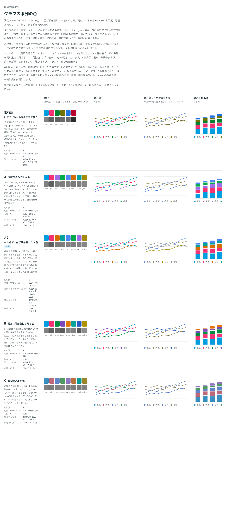

# 0531. グラフの系列の色は、明度をそろえた 8 色を、色覚の型でも隣が見分けられる順に並べる

- ステータス: Accepted
- 日付: 2026-10-16
- ラウンド: 後半 軸 659

## 背景

グラフ（Sparkline・BarList と、あとで作る線・棒・円）で系列を塗り分ける色の並びがありませんでした。MeterGroup は書かないとき primary・secondary・neutral の順に塗るので、4 つ目からは `color` の指定が要りました（[ADR-0432](./0432-meter-group.md)）。

系列の色は、名前の付いた色（green など）と同じ並びにすることにしました。状態の色（success など）とは別の、区別のための色として持ちます。

## 候補

| 案         | 作り方                              | 結果                                                        |
| ---------- | ----------------------------------- | ----------------------------------------------------------- |
| 現行版     | 既存の色をそのまま並べる            | success-700 と warning-700 の差が ΔE 3.0 で、見分けられない |
| A          | 明度を OKLCH L 0.64 にそろえた 8 色 | 見た目の印象はいちばんよいが、D 型で隣の差が 3.2〜3.4       |
| A2（採用） | A の色のまま、並び順を直す          | 先頭 4 色のどの 2 色も 8.1 以上、隣どうしは 8.6 以上        |
| B          | 明暗を交互に置く                    | 見分けやすいが、暗い色が重く、系列に序列があるように見える  |
| C          | 彩度を落とす                        | 静かだが、細い線で色が読めない                              |

## 決定

**系列の色は次の 8 色を、この順に使います。** `--color-series-1`〜`--color-series-8` として持ち、名前の付いた色（`--palette-<名前>-500`）と同じ値です。

| 順  | 名前       | 値        |
| --- | ---------- | --------- |
| 1   | sky-500    | `#009edf` |
| 2   | pink-500   | `#f53273` |
| 3   | orange-500 | `#d36d02` |
| 4   | mint-500   | `#04a19b` |
| 5   | blue-500   | `#3b8af7` |
| 6   | green-500  | `#01a84d` |
| 7   | purple-500 | `#9e6de7` |
| 8   | yellow-500 | `#a58a07` |

- 明度はすべて OKLCH L 0.64 です。彩度は 0.18 を目標にし、出せない色は下げました。白地とのコントラスト比は 3.1〜3.6 です
- 青は、比較で使った `#4c87f8` が既存の blue-500 と色相 4° しか違わないので、既存の値に寄せました
- 青緑は、既存の mint-50 と色相が同じなので mint-500 と名付けました

使うときの前提です。

- 2 系列以上では凡例をいつも出し、4 系列までは名前を線や棒のそばに直接書きます。色だけで系列を伝えません
- 数値は hover と表でも見られるようにします
- 散布図のように点だけで見分けるものは 3 系列までにします
- 9 系列目からは色を作らず、「その他」にまとめます
- 状態の色（成功・警告・危険）は系列に使いません

## 理由

ユーザーの返事の原文です。

> パッと見は A が一番印象がいいですね。色覚異常のある方などを考慮するとどうでしょうか？

> 一旦 A2 でいきましょう。

以下は、決めたときの考えです。

- **明度をそろえる**: 明度が違うと、暗い色の系列が強く見え、系列に序列があるように読めます。そろえると、色相だけで見分けることになるので、並び順が効きます
- **並び順で隣を離す**: A の順では、1・3 番（水色・紫）と 2・4 番（ピンク・緑）が、D 型（緑が見えにくい型）の見え方で ΔE 3.2〜3.4 しか離れていませんでした。A2 は同じ色のまま順を入れ替え、よく使う先頭 4 色のどの 2 色を比べても 8.1 以上、隣どうしは 8.6 以上（ふつうの見え方では 16.9 以上）にしました
- **1 番は水色**: ブランドの色に近い水色を 1 番にし、1 系列だけのグラフ（Sparkline・BarList）がブランドの色になるようにしました。面用の水色（brand）は白地で細い線に使えないので、系列の色は少し暗い sky-500 です

## 却下した案と理由

- **現行版**: 既存の色には、見分けられない組（success-700 と warning-700）がありました
- **A**: 色は A2 と同じです。並び順だけが違い、色覚の型によっては隣が見分けにくくなります
- **B**: 明暗の差で見分けやすくなる一方、暗い色が重く、系列に序列があるように見えます
- **C**: 彩度を落とすと、2px の線では色が読み取れません

## 影響

- `design/tokens.css`: 名前の付いた色（sky・pink・orange・mint・blue・green・purple・yellow の 500）と、`--color-series-1`〜`8` を足しました
- Sparkline・BarList の `brand` は `--color-series-1` で塗ります
- ダークモードの系列の色は、まだ決めていません

## 原則への反映

原則 6 に、系列の色の段落を足しました。区別のための色は状態の色と分けて持ち、明るさをそろえ、色覚の型でも隣どうしが見分けられる順に並べる、という文です。

決めた時点のコミットは `c34fe81b` です。

## 比較画像

