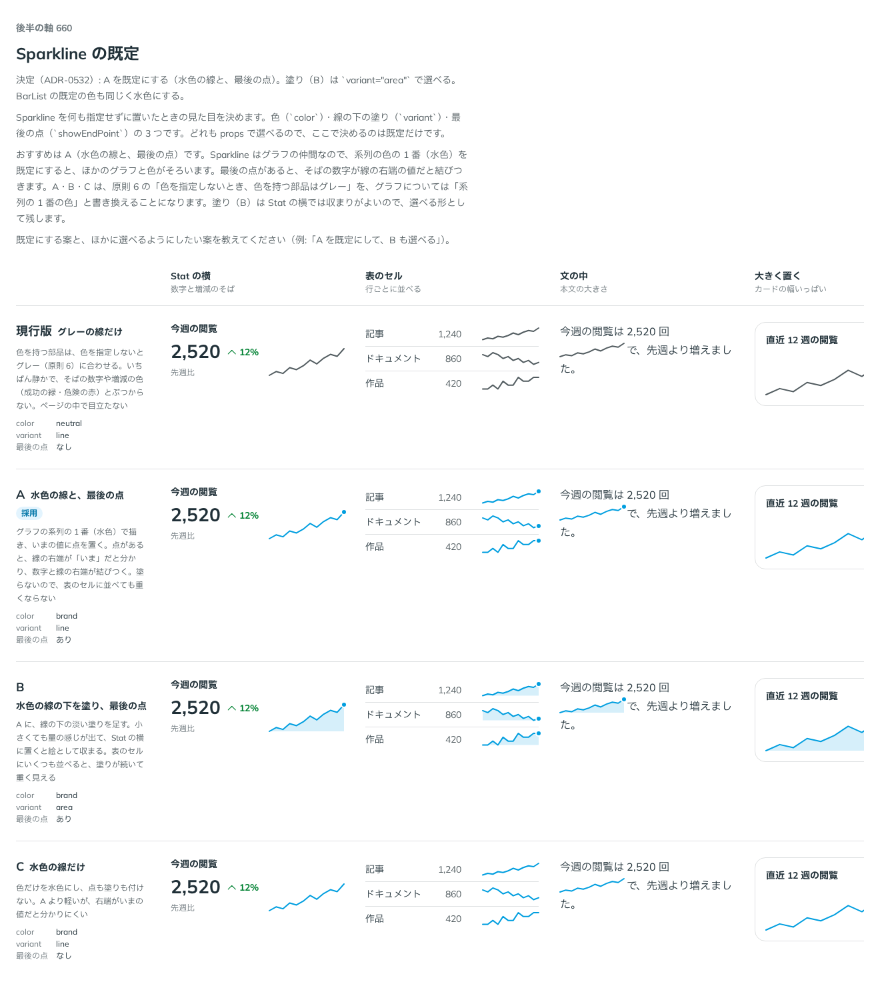

# 0532. Sparkline は、系列の 1 番の色の線と最後の点が既定。BarList の色も系列の 1 番が既定

- ステータス: Accepted
- 日付: 2026-10-16
- ラウンド: 後半 軸 660

## 背景

Sparkline を何も指定せずに置いたときの、色・線の下の塗り・最後の点を決める必要がありました。どれも props で選べるので、決めるのは既定だけです。

## 候補

| 案        | 色                  | 線の下の塗り | 最後の点 |
| --------- | ------------------- | ------------ | -------- |
| 現行版    | 濃いグレー          | なし         | なし     |
| A（採用） | 水色（系列の 1 番） | なし         | あり     |
| B         | 水色                | あり         | あり     |
| C         | 水色                | なし         | なし     |

## 決定

**Sparkline の既定は、水色（`--color-series-1`）の線と、最後の値の点です。** 線の下の塗りは `variant="area"` で選べ、点は `hideEndPoint` で消せます。

**BarList の既定の色も、同じ水色にします。** どちらも `color="brand"` は、面用の水色（`--color-brand`）ではなく、白地で細い線や棒に使える系列の 1 番の水色を指します。 グラフの仲間は、色を指定しないとき系列の 1 番の色で描きます。目立たせたくないときは `neutral`（濃いグレー）を選びます。

## 理由

ユーザーの返事の原文です。

> 660 は既定 A でよさそう。

以下は、決めたときの考えです。

- **グラフの色をそろえる**: Sparkline はグラフの仲間なので、系列の 1 番を既定にすると、ほかのグラフと色がそろいます
- **最後の点**: 点があると、線の右端が「いま」の値だと分かり、そばの数字と結びつきます
- **塗りは選べる形**: 塗ると Stat の横では絵として収まりますが、表のセルにいくつも並べると重く見えます

## 却下した案と理由

- **現行版**: いちばん静かですが、グラフだと分かりにくく、ほかのグラフと色がそろいません
- **B**: 既定にはせず、`variant="area"` で選べるようにしました
- **C**: 右端がいまの値だと分かりにくくなります

## 影響

- `src/components/sparkline/Sparkline.tsx`: `color` の既定を `brand`、最後の点を既定で出し、消す props を `hideEndPoint` にしました（既定で出るものは `hide<何>`）
- `src/components/bar-list/BarList.tsx`: `color` の既定を `brand` にしました

## 原則への反映

原則 6 の「色を指定しないとき、色を持つ部品はすべてグレー」を書き換えました。グラフの仲間は、色を指定しないとき系列の 1 番の色で描きます。

決めた時点のコミットは `ea790430` です。

## 比較画像

