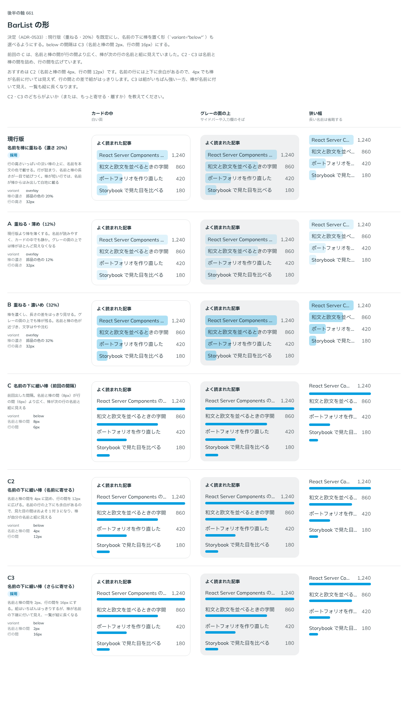

# 0533. BarList は、名前を淡い棒に重ねる形が既定。名前の下に細い棒を置く形も選べる

- ステータス: Accepted
- 日付: 2026-10-16
- ラウンド: 後半 軸 661

## 背景

BarList（名前と値の並びを、値の大きさの棒で見せる一覧）の形を決める必要がありました。名前を淡い棒に重ねる形と、名前の下に細い棒を置く形です。重ねる形では棒の濃さを、下に置く形では名前と棒の間隔を決めます。

## 候補

| 案             | 形               | 棒                               | 間隔                      |
| -------------- | ---------------- | -------------------------------- | ------------------------- |
| 現行版（採用） | 名前を棒に重ねる | 部品の色の 20%                   | 行の高さ 32px             |
| A              | 重ねる           | 12%                              | 同上                      |
| B              | 重ねる           | 32%                              | 同上                      |
| C              | 名前の下に細い棒 | 部品の色の塗り・Meter と同じ太さ | 名前と棒 8px・行の間 6px  |
| C2             | 名前の下に細い棒 | 同上                             | 名前と棒 4px・行の間 12px |
| C3（選べる形） | 名前の下に細い棒 | 同上                             | 名前と棒 2px・行の間 16px |

C2・C3 は、C を見た返事を受けて足しました。

## 決定

**名前を淡い棒に重ねる形を既定にします。** 棒は部品の色の 20% で、行の高さいっぱいです。

**名前の下に細い棒を置く形も、`variant="below"` で選べます。** 名前と棒の間は 2px、行の間は 16px です。

## 理由

ユーザーの返事の原文です。

> 661 は現行で良さそう。C はちょっと感覚的にもう少し文字の下と Meter の空白は近くないと、グループっぽく見えないかも。

> C3 でよさそう

以下は、決めたときの考えです。

- **重ねる形は詰まる**: 行が詰まり、カードの中の短い一覧（よく読まれた記事など）に収まります
- **20%**: 12% ではグレーの面の上で棒がほとんど見えず、32% では名前の文字が沈みます
- **棒の淡さを地に頼らない**: 淡い棒は、地ではなく透明に混ぜて作ります。白に混ぜると、グレーの面の上で白く浮いていました
- **下に置く形の間隔**: C は名前と棒の間（8px）が行の間（6px）より広く、棒が次の行の名前と組に見えていました。名前と棒の間を行の間よりはっきり狭くすると、棒が自分の名前と組に見えます

## 却下した案と理由

- **A・B**: 上の濃さの理由のとおりです
- **C・C2**: C は組が逆に見えます。C2 も組には見えますが、C3 のほうがはっきりします

## 影響

- `src/components/bar-list/BarList.tsx`: `variant` の既定は `overlay` です
- `src/components/bar-list/bar-list.tokens.css`: `--bar-list-fill-mix`（20%）、`--bar-list-below-gap`（2px）、`--bar-list-below-row-gap`（16px）

## 原則への反映

反映なし。原則 4（ラベル・本体・キャプションの近さで組を作る）の範囲です。

決めた時点のコミットは `bbbe510f` です（重ねる形と濃さは `7a99473f` の比較で決めました）。

## 比較画像

