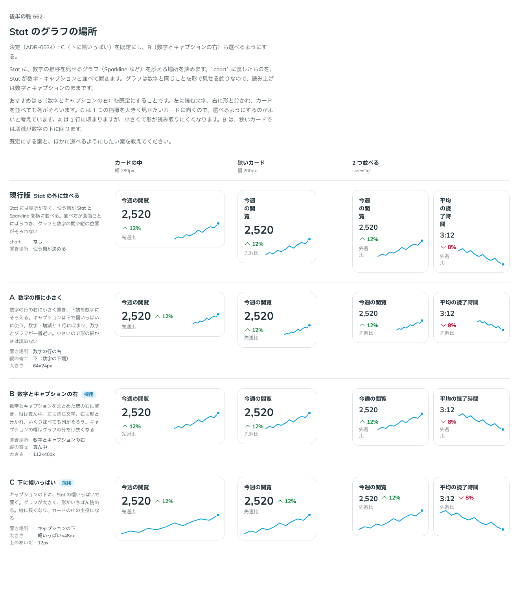

# 0534. Stat のグラフは、キャプションの下に幅いっぱいが既定。数字とキャプションの右にも置ける

- ステータス: Accepted
- 日付: 2026-10-17
- ラウンド: 後半 軸 662

## 背景

Stat には、数字の推移を見せるグラフ（Sparkline など）を添える場所がありませんでした（2026-10-01 のトリアージで、グラフ系の設計のときに決めることにしたもの）。使う側が Stat と Sparkline を並べると、間や縦の位置が画面ごとにばらつき、狭いカードではラベルが 1〜2 文字ずつ折り返していました。

## 候補

| 案            | 置き場所                           | 大きさ          |
| ------------- | ---------------------------------- | --------------- |
| 現行版        | Stat の外に、使う側が並べる        | 使う側が決める  |
| A             | 数字の行の右に小さく               | 64×24px         |
| B（選べる形） | 数字とキャプションの右、縦は真ん中 | 112×40px        |
| C（採用）     | キャプションの下に幅いっぱい       | 幅いっぱい×48px |

## 決定

**`chart` に渡したグラフを、キャプションの下に幅いっぱいで置くのが既定です。** キャプションとの間は 12px、高さは 48px です。

**`chartPlacement="end"` で、数字とキャプションの右にも置けます。** 縦は真ん中で、大きさは 112×40px です。

グラフは数字と同じことを形で見せる飾りなので、読み上げは数字とキャプションのままです。読み込み中（`loading`）は、数字と同じく出しません。

## 理由

ユーザーの返事の原文です。

> C が一番一般的？と思いましたが、B が一番良いです？

> Cデフォ、B も選べるで良さそう

はじめは B を推していました。カードを並べたとき、文字が左、グラフが右と列がそろうためです。返事を受けて比べ直し、C を推し直しました。

- **指標のカードでよく見る形**: 数字の下に幅いっぱいの小さなグラフを置く形は、指標を並べるカードでいちばん多く見かけます
- **横幅を取り合わない**: B は、幅 280px のふつうのカードでも、増減が数字の下に回っていました。C は狭いカードでも数字と増減が 1 行に収まり、寄せ方（`align`）を変えても崩れません
- **グラフを添えるのは推移を見せたいとき**: 縦に長くなりますが、グラフが大きく読めるほうが目的に合います
- **1 行に並べたいとき**: 縦を詰めたい場面のために B を残しました。表のセルや文の中には Sparkline をそのまま置けます

## 却下した案と理由

- **現行版**: 並べ方が画面ごとにばらつきます
- **A**: 1 行に収まりますが、グラフが小さく、形が読み取りにくくなります

## 影響

- `src/components/stat/Stat.tsx`: `chart`（ReactNode）と `chartPlacement`（`bottom`・`end`。既定は `bottom`）を足しました。グラフは dd の中に置きます
- `src/components/stat/stat.tokens.css`: `--stat-chart-offset`・`--stat-chart-height`（bottom）と、`--stat-chart-gap`・`--stat-chart-end-width`・`--stat-chart-end-height`（end）
- グラフを添えるときは、寄せ方（`align`）で縮まないよう、dd を Stat の幅いっぱいにします

## 原則への反映

反映なし。原則 4（ラベル・本体・キャプションの 3 層）の並びに、グラフを本体の続きとして足す形です。

決めた時点のコミットは `5573e80e` です（`chartPlacement` に畳んだのは `0b5d26aa`）。

## 比較画像

