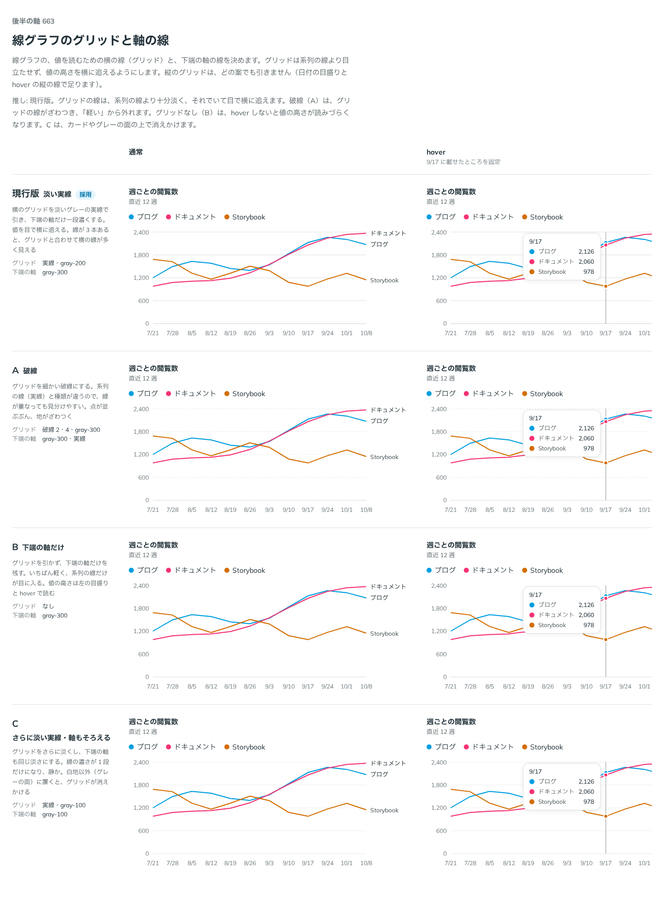

# 0535. 本格的なグラフは見た目だけを部品にし、グリッドと軸の線は淡い実線と一段濃い下端の軸にする

- ステータス: Accepted
- 日付: 2026-10-17
- ラウンド: 後半 軸 663

## 背景

線・棒・円のような本格的なグラフ（Recharts など）を、部品としてどう持つかを決める必要がありました。グラフは描画そのものが重く、DataTable や Sortable と同じ事情です。あわせて、最初の線グラフで、横のグリッドと下端の軸をどんな線にするかも決めました。

グリッドと軸の線は Recharts が描くので、部品が決められるのは色とレシピの既定だけです。

## 候補

背景の方針は候補を並べずに決めたので、比較したのは線の形だけです。

| 案             | グリッド            | 下端の軸       |
| -------------- | ------------------- | -------------- |
| 現行版（採用） | 実線・gray-200      | gray-300       |
| A              | 破線 2・4・gray-300 | gray-300・実線 |
| B              | なし                | gray-300       |
| C              | 実線・gray-100      | gray-100       |

## 決定

**グラフは、見た目だけを部品にします。** Recharts とのつなぎ（軸・グリッド・線・hover の描き方）は `src/recipes/line-chart/` のレシピに置き、`recharts` は devDependencies だけに入れます。部品は Recharts を import せず、peer dependency にもしません。[ADR-0335](./0335-headless-look-only-recipes.md) と同じ分け方です。まずは Recharts を前提にしたレシピを書きます。

**グリッドは gray-200 の実線、下端の軸は一段濃い gray-300 が既定です。** 色は役割のトークン `--color-chart-grid`・`--color-chart-axis` にあります。破線やグリッドなしはグリッドを描くのがライブラリなので、部品の props にはせず、レシピ側で変えます（レシピの `grid` に `solid`・`dashed`・`none`）。使う側は自分のグラフで同じ値を書き換えられます。

## 理由

ユーザーの返事の原文です。

> まずは recharts 前提にしましょう

> 使わないなら依存に入れなくてよくしたい、というスタンスなので、今の分け方でお願いします。

> 方針としては、テーブル等に則り、見た目を提供し、ユーザーにライブラリとの結合をやってもらう、というのが慣例になっています。

グリッドと軸の線については、次のとおりです。

> これってデフォルトの話ですか？それとも択一の選択肢という話ですか？

既定の話で、グリッドは Recharts が描くので、ほかの形はレシピで変えられる、と答えました。

> 既定は実線で良さそう。

現行版を推していました。

- **淡い実線**: グリッドが系列の線より十分淡く、それでいて目で横に追えます
- **A（破線）**: 点が並んで、グリッドがざわつきます。「軽い」から外れます
- **B（グリッドなし）**: hover しないと値の高さが読みづらくなります
- **C（さらに淡い）**: カードやグレーの面の上で、グリッドが消えかけます

## 却下した案と理由

- **部品が Recharts を取り込む（peer dependency）**: 使わない人にも依存が入ります。Recharts の版が上がるたびにこちらも版を出すことになります
- **A**: 上の理由のとおり、ざわつきます。ただし、レシピの `grid="dashed"` で選べます
- **B**: 同じく、`grid="none"` で選べます
- **C**: 面の上で消えかけます

## 影響

- `src/recipes/line-chart/PageViewsLineChart.tsx`: Recharts のグラフ。`grid`（`solid`・`dashed`・`none`。既定は `solid`）
- `design/tokens.css`: `--color-chart-grid`（gray-200）・`--color-chart-axis`（gray-300）
- `package.json`: `recharts` は devDependencies だけ
- 比較用だった `--chart-grid-dash` は、決めたあとで畳みました

## 原則への反映

反映なし。原則 20（部品は知らないことを決めない）に沿った分け方で、線の描き方はライブラリとレシピに任せます。

決めた時点のコミットは `cb64e7c0` です（比較のための破線のトークン `--chart-grid-dash` を畳んだのは `1b512454`）。

## 比較画像

