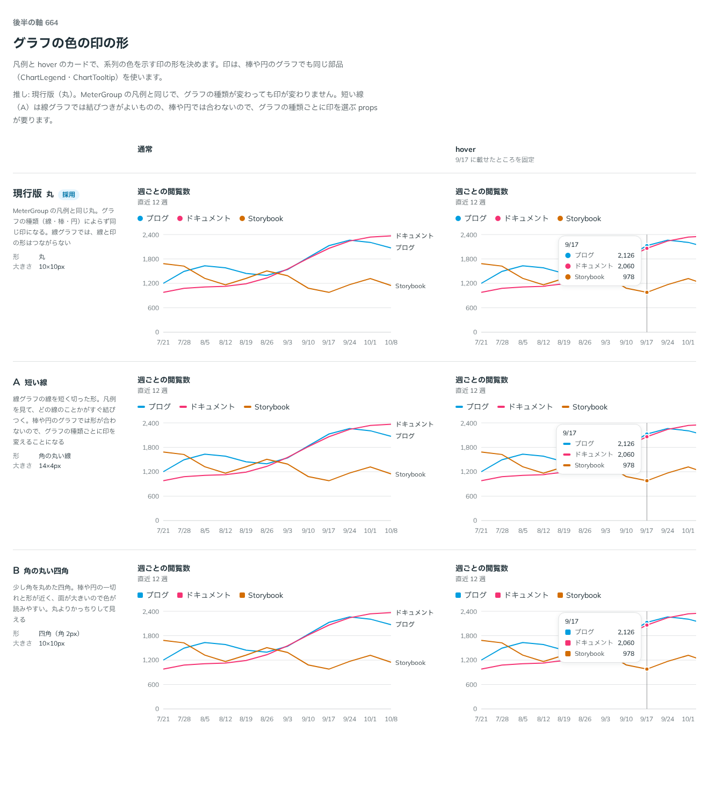

# 0536. グラフの色の印は丸が既定。短い線・四角も markerType で選べる

- ステータス: Accepted
- 日付: 2026-10-17
- ラウンド: 後半 軸 664

## 背景

凡例と hover のカードには、系列の色を示す小さな印を置きます。この印の形を決める必要がありました。MeterGroup の凡例は丸の印を使っています。

## 候補

| 案             | 形             | 大きさ  |
| -------------- | -------------- | ------- |
| 現行版（採用） | 丸             | 10×10px |
| A（選べる形）  | 角の丸い短い線 | 14×4px  |
| B（選べる形）  | 四角（角 2px） | 10×10px |

## 決定

**丸（10×10px）が既定です。** `markerType` で、短い線（`dash`、14×4px）と、角を少し丸めた四角（`square`、10×10px、角 2px）も選べます。値は `dot`・`dash`・`square` で、List の `markerType` の `dot`・`dash` にそろえました。

`markerType` は ChartLegend と ChartTooltip が持ちます。

## 理由

ユーザーの返事の原文です。

> 現行をデフォルトで、他も選びたいですね

現行版を推していました。

- **MeterGroup の凡例と同じ**: 部品をまたいで、系列の色の印が同じ形になります
- **グラフの種類によらない**: 線・棒・円のどれでも同じ印で済みます
- **A（短い線）**: 線グラフでは線との結びつきがよいものの、棒や円では形が合いません
- **B（四角）**: 棒や円の一切れに近く、面が大きくて色が読みやすい一方、丸よりかっちりして見えます

## 却下した案と理由

どの案も外していません。A・B は `markerType` で選べます。

## 影響

- `src/components/chart/ChartMarker.tsx`: `chartMarker`（`markerType` の `dot`・`dash`・`square`）と、型 `ChartMarkerType`
- `src/components/chart/ChartLegend.tsx`・`ChartTooltip.tsx`: `markerType` を足しました
- `src/components/chart/chart.tokens.css`: `--chart-marker-dot-size`・`--chart-marker-dash-width`・`--chart-marker-square-size`

## 原則への反映

反映なし。原則 6（色は役割で持つ）の、系列の色を示す印の形の話です。

決めた時点のコミットは `1b512454` です（`markerType` に畳んだのは `4fdb1024`）。

## 比較画像

