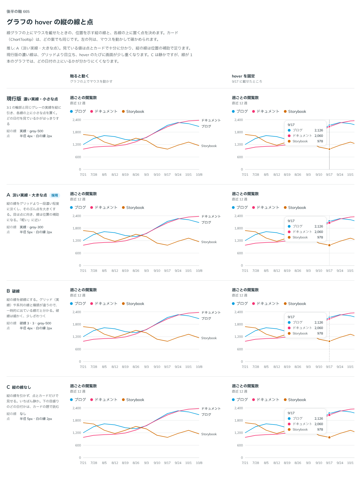

# 0537. hover の縦の線は淡い実線、点は少し大きくする

- ステータス: Accepted
- 日付: 2026-10-17
- ラウンド: 後半 軸 665

## 背景

線グラフに hover すると、その位置に縦の線と、各線の上に点が出ます。縦の線の濃さと種類、点の大きさを決める必要がありました。

## 候補

| 案        | 縦の線              | 点                   |
| --------- | ------------------- | -------------------- |
| 現行版    | 実線・gray-500      | 半径 4px・白の縁 2px |
| A（採用） | 実線・gray-300      | 半径 5px・白の縁 2px |
| B         | 破線 3・3・gray-500 | 半径 4px・白の縁 2px |
| C         | なし                | 半径 5px・白の縁 2px |

## 決定

**縦の線は gray-300 の実線、点は半径 5px（白の縁 2px）です。** 色は役割のトークン `--color-chart-cursor` で、点の半径は `--chart-dot-radius` です。

## 理由

ユーザーの返事の原文です。

> A かな。

A を推していました。

- **見たいのは点とカード**: 見ている値は点とカードで十分に分かり、縦の線は位置の補助で足ります
- **現行版の濃い線**: グリッドより目立ち、hover のたびに画面が少し重くなります
- **C（線なし）**: 静かですが、線が 1 本のグラフでは、どの日付の上にいるかが分かりにくくなります

## 却下した案と理由

- **現行版**: 縦の線が濃く、hover のたびに画面が重くなります
- **B**: 破線は細かく、少しざわつきます
- **C**: 上のとおり、どの日付かが分かりにくくなります

## 影響

- `design/tokens.css`: `--color-chart-cursor`（gray-300）
- `src/components/chart/chart.tokens.css`: `--chart-dot-radius`（5px）。線の上にいつも置く小さな点の `--chart-dot-sm-radius` は別です
- `src/components/chart/ChartMarks.tsx`: `ChartDot`
- `src/recipes/line-chart/PageViewsLineChart.tsx`: Recharts の `Tooltip` の `cursor` に `--color-chart-cursor` を渡します
- 比較用だった切り替えのトークンは、決めたあとで畳みました

## 原則への反映

反映なし。原則 3（hover は手応え）の、グラフの上での出し方です。濃さは線を足すだけの補助に留めます。

決めた時点のコミットは `4fdb1024` です（A の値に畳んだのは `393250de`）。

## 比較画像

