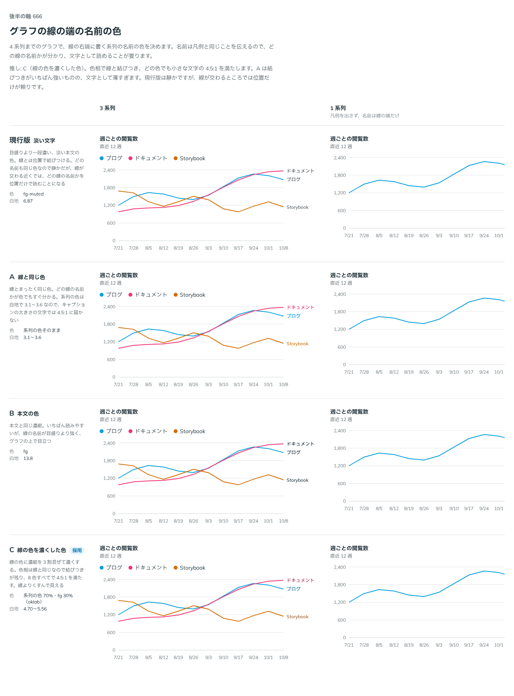

# 0538. 線の端の名前は、線の色を濃くした色が既定。ほかの色も選べる

- ステータス: Accepted
- 日付: 2026-10-17
- ラウンド: 後半 軸 666

## 背景

線グラフの線の右端に、系列の名前を書きます（凡例の代わり、または添え）。この文字の色を決める必要がありました。

## 候補

| 案                 | 色                            | 白地の対比 |
| ------------------ | ----------------------------- | ---------- |
| 現行版（選べる形） | fg-muted                      | 6.87       |
| A（選べる形）      | 系列の色そのまま              | 3.1〜3.6   |
| B（選べる形）      | fg                            | 13.8       |
| C（採用）          | 系列の色 70%・fg 30%（oklab） | 4.70〜5.56 |

## 決定

**線の色に fg を 3 割混ぜて濃くした色（`tinted`）が既定です。** `ChartLineLabel` の `variant` で、`series`（線と同じ色）・`body`（本文の色）・`muted`（淡い本文の色）も選べます。

## 理由

ユーザーの返事の原文です。

> Cデフォで良さそう。明示しない限り、基本は他の択も選べる形にしてください。

C を推していました。

- **色相で線と結びつく**: どの線の名前かを、位置だけでなく色でも読めます
- **小さな文字の対比を満たす**: 8 色すべてで 4.5:1 になります
- **A**: 結びつきはいちばん強いものの、キャプションの大きさの文字では薄すぎます
- **現行版**: 静かですが、線が交わるところでは位置だけが頼りです
- **B**: 読みやすい反面、目盛りより強く、グラフの上で目立ちます

返事のあとの一言は、このリポジトリの進め方にもなりました。軸を決めたら、明示がない限り、ほかの案も props で選べる形にします。

## 却下した案と理由

どの案も外していません。現行版・A・B は `variant` で選べます。

## 影響

- `src/components/chart/ChartMarks.tsx`: `ChartLineLabel` に `variant`（`tinted`・`series`・`body`・`muted`。既定は `tinted`）を足しました。型は `ChartLineLabelVariant`
- `src/components/chart/chart.tokens.css`: `--chart-label-tint`（70%）、`--chart-label-gap`

## 原則への反映

原則 6 に「線のそばに書く名前は、系列の色を本文の濃い色に寄せて、細い文字でも読める濃さにする」を足しました。原則 12（色は面用と前景用の 2 段で持つ）に沿った、文字としての対比の確かめでもあります。

決めた時点のコミットは `393250de` です（`variant` に畳んだのは `e127e2ca`）。

## 比較画像

