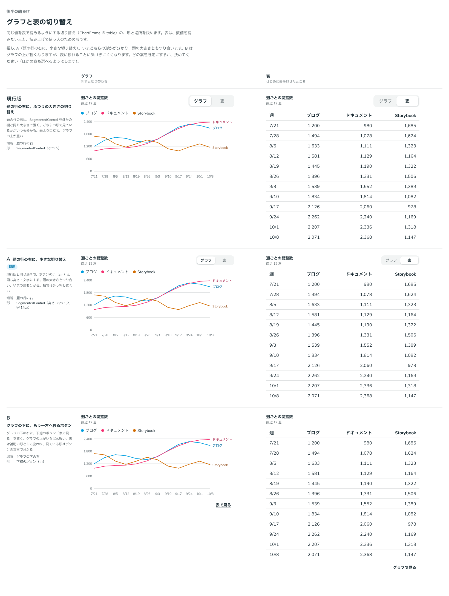

# 0539. グラフと表の切り替えは、題の行の右に小さな切り替え。ふつうの大きさと下線のボタンも選べる

- ステータス: Accepted
- 日付: 2026-10-17
- ラウンド: 後半 軸 667

## 背景

グラフは目で形を読むもので、表は値を正確に読むものです。同じ値を表でも見られるよう、ChartFrame に「グラフ・表」の切り替えを足します。この切り替えの形と場所を決める必要がありました。

## 候補

| 案                 | 場所       | 形                                       |
| ------------------ | ---------- | ---------------------------------------- |
| 現行版（選べる形） | 題の行の右 | SegmentedControl（ふつうの大きさ）       |
| A（採用）          | 題の行の右 | SegmentedControl（高さ 36px・文字 14px） |
| B（選べる形）      | 題の行の右 | 下線のボタン（小）                       |

B は、はじめはグラフの下の右に置く案でした。返事を受けて、題の行の右に動かした形で残しています。

## 決定

**題の行の右に、ボタンの小（sm）と同じ大きさの「グラフ・表」の切り替えを置くのが既定です。** `viewToggleSize="md"` で、ほかの欄と同じふつうの大きさにもできます。

**`viewToggle="button"` で、もう一方の形へ移る下線のボタン（「表で見る」）にもできます。**

## 理由

ユーザーの返事の原文です。

> A でいいかなと。現行だと結構デカいですね。B 案だとしても右上配置が理想かなと思いました。

A を推していました。

- **いまの形が分かる**: SegmentedControl は、グラフと表のどちらを見ているかをいつも示します
- **題とつり合う**: 現行版は題より目立ち、グラフの上が重くなります。小さくすると題の大きさとつり合います
- **B**: グラフの上は軽くなりますが、表に移れることに気づきにくくなります

指では A が少し押しにくいため、ふつうの大きさも残しました。

## 却下した案と理由

どの案も外していません。現行版は `viewToggleSize="md"`、B は `viewToggle="button"` で選べます。

## 影響

- `src/components/chart/ChartFrame.tsx`: `viewToggle`（`segmented`・`button`。既定は `segmented`）、`viewToggleSize`（`sm`・`md`。既定は `sm`）
- 比較用だった `--chart-toggle-header`・`--chart-toggle-footer` は、決めたあとで畳みました

## 原則への反映

反映なし。原則 18（働きで部品を選び、見た目は別に選ぶ）に沿って、切り替えの働きは変えず、見た目だけを選べます。

決めた時点のコミットは `6d736d11` です（`viewToggle` と `viewToggleSize` に畳んだのは `396c56b4`）。

## 比較画像

