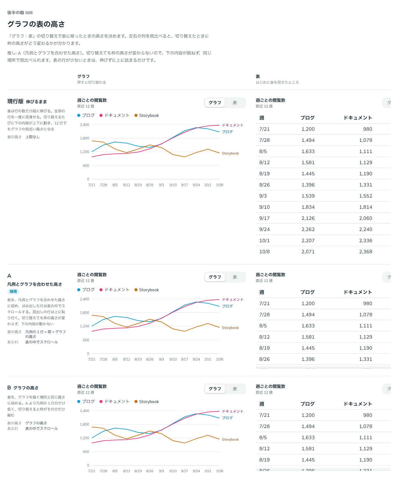

# 0540. 表に切り替えても枠の高さを変えない。表の高さは凡例とグラフを合わせた高さに測る

- ステータス: Accepted
- 日付: 2026-10-17
- ラウンド: 後半 軸 668

## 背景

ChartFrame は、グラフから表に切り替えられます。表は行の数だけ縦に伸びるので、切り替えるたびに下の内容が上下に動いていました。12 行の表では、グラフの倍近い高さになります。

## 候補

| 案                 | 表の高さ                        | あふれ             |
| ------------------ | ------------------------------- | ------------------ |
| 現行版（選べる形） | 上限なし（伸びるまま）          | 伸びる             |
| A（採用）          | 凡例の 1 行 + 間 + グラフの高さ | 表の中でスクロール |
| B                  | グラフの高さ                    | 表の中でスクロール |

## 決定

**表の高さを、グラフのときの凡例とグラフを合わせた高さに合わせます。** 切り替えても枠の高さが変わらず、下の内容が動きません。あふれた行は表の中でスクロールし、見出しの行は上に貼り付きます。凡例が折り返して高くなっても、測ってそろえます。

短い表でも枠は縮めません。表は上に詰まって、下は空いたままです。

**`tableHeight="auto"` で、行の数だけ伸びるままにもできます。** 既定は `chart` です。

## 理由

ユーザーの返事の原文です。

> グラフだった時の要素の高さと揃えたいですね（切り替えたときに高さが変わらないようにする。見出しは張り付く）

A を推していました。

- **下の内容が跳ねない**: 切り替えても、同じ場所でグラフと表を見比べられます
- **B**: 凡例の 1 行ぶん低くなり、切り替えると枠がその分だけ縮みます

「凡例が折り返しても正確に」は、A を最初の比較の式（凡例を 1 行と仮定）で書いていたところを、実際の高さを測る形に直したものです。

## 却下した案と理由

- **B**: 枠が縮んで、下の内容が動きます
- **現行版**: 上の理由のとおり跳ねます。ただし、`tableHeight="auto"` で選べます

## 影響

- `src/components/chart/ChartFrame.tsx`: `tableHeight`（`chart`・`auto`。既定は `chart`）。Table に `maxHeight="var(--chart-table-max-height)"` を渡すと、表の中でスクロールします
- `src/recipes/line-chart/PageViewsLineChart.tsx`: Table の `maxHeight` に ChartFrame の値を渡します
- 比較用だった `--chart-table-max-height` は、ChartFrame が測って与える値になりました

## 原則への反映

反映なし。レイアウトの安定の話で、既存の原則の例外にも書き換えにもなりません。

決めた時点のコミットは `fb1abff2` です（`tableHeight` に畳んだのは `e002c877`）。

## 比較画像

