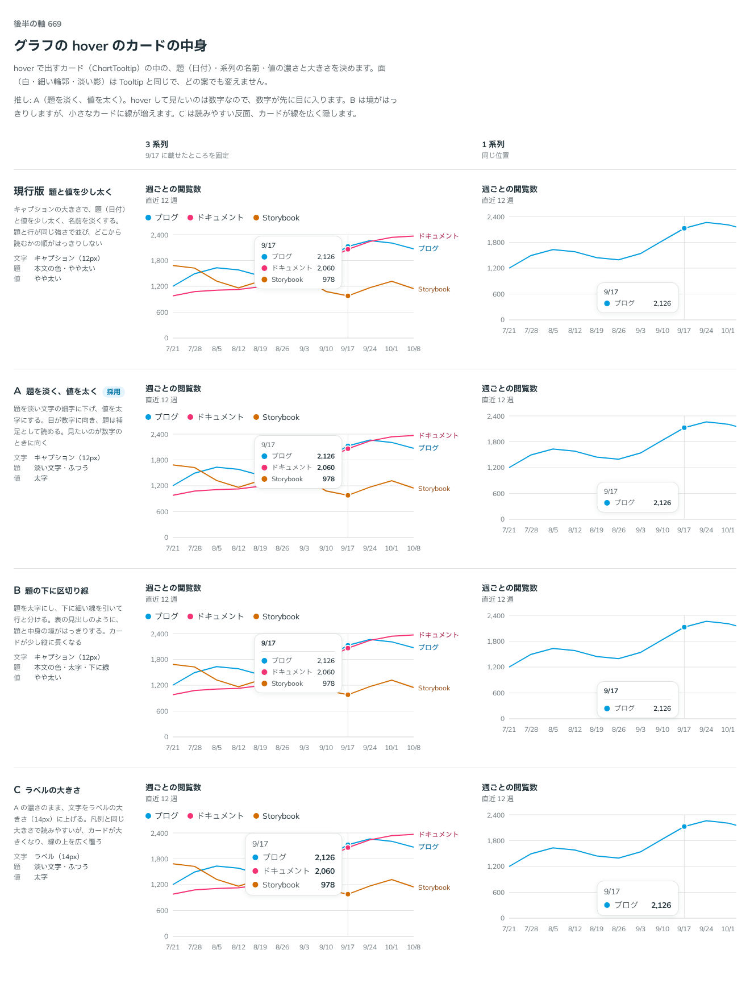

# 0541. hover のカードは、題を淡く値を太くする形が既定。ほかの形は variant と size で選べる

- ステータス: Accepted
- 日付: 2026-10-17
- ラウンド: 後半 軸 669

## 背景

線グラフに hover すると、日付（題）と、系列ごとの名前と値のカードが出ます。題・名前・値の濃さと大きさを決める必要がありました。

## 候補

| 案                 | 文字              | 題                     | 値       |
| ------------------ | ----------------- | ---------------------- | -------- |
| 現行版（選べる形） | キャプション 12px | 本文の色・やや太い     | やや太い |
| A（採用）          | キャプション 12px | 淡い文字・ふつう       | 太字     |
| B（選べる形）      | キャプション 12px | 本文の色・太字・下に線 | やや太い |
| C（選べる形）      | ラベル 14px       | 淡い文字・ふつう       | 太字     |

## 決定

**題を淡い文字のふつうの太さにし、値を太字にする形（`value`）が既定です。** 文字はキャプションの大きさ（12px）です。

ChartTooltip の `variant` と `size` で、ほかの形も選べます。

| prop      | 値                                                                                             | 既定    |
| --------- | ---------------------------------------------------------------------------------------------- | ------- |
| `variant` | `value`（題を淡く値を太く）・`balanced`（題と値をやや太く）・`divided`（題を太字にして下に線） | `value` |
| `size`    | `sm`（キャプション）・`md`（ラベルの大きさ）                                                   | `sm`    |

現行版は `balanced`、B は `divided`、C は `value` に `size="md"` です。`balanced` は、決めたあとで `even` から改名しました。ユーザーの指摘は「tooltip.variant even がちょっと分かりづらいかも？」でした。

## 理由

ユーザーの返事の原文です。

> デフォルトは A かな。

A を推していました。

- **見たいのは数字**: hover して見たいのは値なので、数字が先に目に入ります
- **現行版**: 題と行が同じ強さで並び、どこから読むかの順がはっきりしません
- **B**: 境ははっきりしますが、小さなカードに線が増えます
- **C**: 読みやすい反面、カードが大きくなり、線を広く隠します

## 却下した案と理由

どの案も外していません。現行版・B・C は `variant` と `size` で選べます。

## 影響

- `src/components/chart/ChartTooltip.tsx`: `variant`（`value`・`balanced`・`divided`。既定は `value`）、`size`（`sm`・`md`。既定は `sm`）。型は `ChartTooltipVariant`・`ChartTooltipSize`
- `src/components/chart/chart.tokens.css`: `--chart-tooltip-padding-x`・`--chart-tooltip-padding-y`・`--chart-tooltip-min-width`・`--chart-tooltip-divider-gap`・`--chart-tooltip-divider-pad`

## 原則への反映

反映なし。原則 4（ラベル・本体・キャプションの 3 層）の、題を淡く本体を濃くする向きに沿った決めです。

決めた時点のコミットは `0ce93dfa` です（`variant` と `size` に畳んだのは `e9a708fe`）。

## 比較画像

