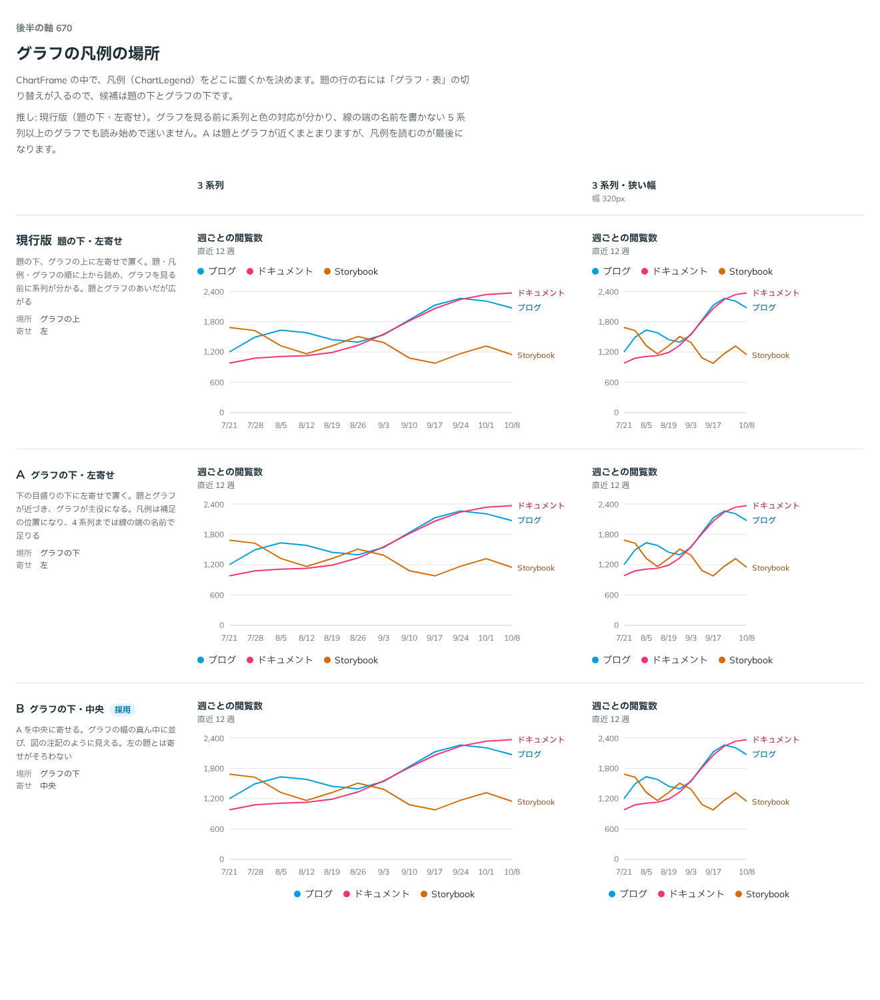

# 0542. 凡例はグラフの下の中央が既定。上と左寄せも選べる

- ステータス: Accepted
- 日付: 2026-10-17
- ラウンド: 後半 軸 670

## 背景

ChartFrame の凡例を、題とグラフに対してどこに置くかを決める必要がありました。

## 候補

| 案                 | 場所                 | 寄せ |
| ------------------ | -------------------- | ---- |
| 現行版（選べる形） | グラフの上（題の下） | 左   |
| A（選べる形）      | グラフの下           | 左   |
| B（採用）          | グラフの下           | 中央 |

## 決定

**凡例はグラフの下の中央が既定です。** 図の注記のように添えます。

`legendPlacement`（`bottom`・`top`）と `legendAlign`（`center`・`start`）で、上や左寄せも選べます。現行版は `top` と `start`、A は `bottom` と `start` です。

## 理由

ユーザーの返事の原文です。

> Bデフォかなあ。図の注記っぽさがあうかなと

はじめは現行版（題の下・左寄せ）を推していました。グラフを見る前に系列と色の対応が分かり、線の端の名前を書かない 5 系列以上のグラフでも読み始めで迷わないためです。返事は B で、凡例を図の注記として扱う見方でした。

- **図の注記**: グラフの下に中央で置くと、凡例が補足の位置に収まります
- **題とグラフが近づく**: グラフが主役になります
- **左の題とは寄せがそろわない**: B の弱みです。そろえたいときは `legendAlign="start"` にします

## 却下した案と理由

どの案も外していません。現行版・A は `legendPlacement`・`legendAlign` で選べます。

## 影響

- `src/components/chart/ChartFrame.tsx`: `legendPlacement`（`bottom`・`top`。既定は `bottom`）、`legendAlign`（`center`・`start`。既定は `center`）
- 比較用だった `--chart-legend-order`・`--chart-legend-justify` は、決めたあとで畳みました

## 原則への反映

反映なし。凡例の場所は、個々のグラフの置き方で、原則の書き換えにはなりません。

決めた時点のコミットは `e57d1114` です（props に畳んだのは `8c6263f6`）。

## 比較画像

