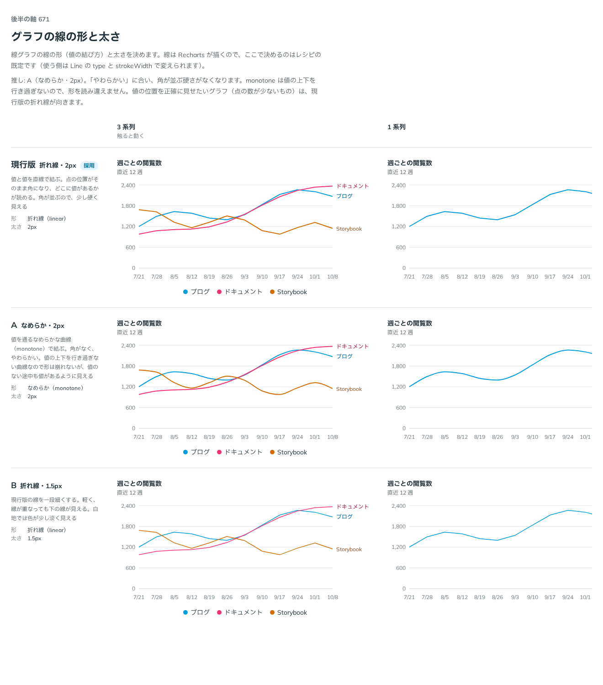

# 0543. レシピの線は折れ線・2px が既定。なめらかな線と細い線は Docs で案内する

- ステータス: Accepted
- 日付: 2026-10-17
- ラウンド: 後半 軸 671

## 背景

線グラフの線は Recharts が描くので、部品の見た目ではありません。それでも、レシピの既定を決める必要がありました。

## 候補

| 案             | 形                   | 太さ  |
| -------------- | -------------------- | ----- |
| 現行版（採用） | 折れ線（linear）     | 2px   |
| A              | なめらか（monotone） | 2px   |
| B              | 折れ線（linear）     | 1.5px |

## 決定

**レシピの既定は折れ線（`linear`）の 2px です。** なめらかな線（`monotone`）や細い線（1.5px）は、Recharts の `Line` の `type` と `strokeWidth` で変えられるので、Docs で案内します。部品の props にはしません。

## 理由

ユーザーの返事の原文です。

> レシピでどういうデータを出すかによりますが、サンプルは現行で良さそう

はじめは A を推していました。角が並ぶ硬さがなくなり、monotone は値の上下を行き過ぎないので、形を読み違えないためです。返事を受けて、点の数が少ないグラフでは折れ線のほうが値の位置を正確に見せることを踏まえ、サンプルは現行版にしました。

- **折れ線**: 点の位置がそのまま角になり、どこに値があるかが読めます
- **A**: やわらかく見えますが、値のない途中にも値があるように見えます
- **B**: 軽く、線が重なっても下の線が見えます。白地では色が少し淡く見えます

## 却下した案と理由

どの案も外していません。A・B は Docs の案内でレシピを書き換えて選びます。

## 影響

- `src/recipes/line-chart/PageViewsLineChart.tsx`: `Line` は `type="linear"`、`strokeWidth` は `--border-width-thick`（2px）
- レシピの線グラフ（`Recipes/LineChart`）の Docs に、`monotone` と細い線（`var(--border-width-medium)`）の書き方を書きました

## 原則への反映

反映なし。原則 20（部品は知らないことを決めない）に沿って、線の形は使うデータで変わるので、部品では決めません。

決めた時点のコミットは `a9abfeae` です。

## 比較画像

