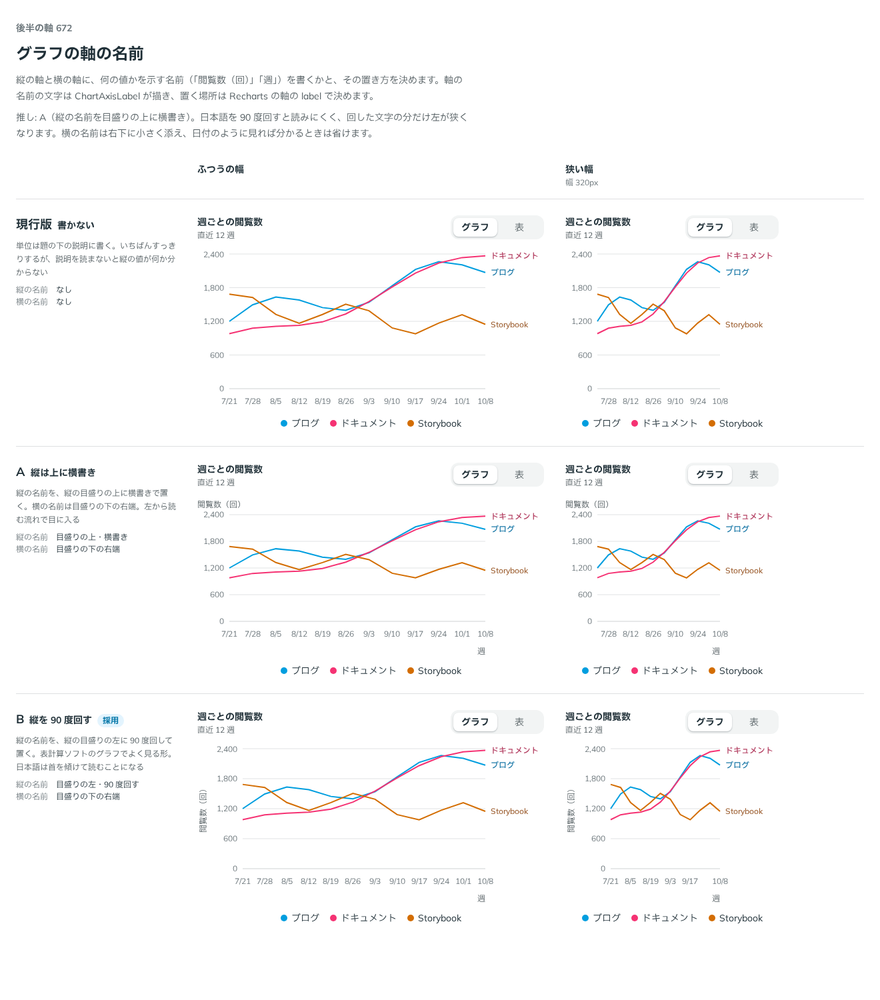

# 0544. グラフの軸の名前は、縦を 90 度回して目盛りの左に、横は単位として最後の目盛りの右に置くのが既定

- ステータス: Accepted
- 日付: 2026-10-31
- ラウンド: 後半 軸 672

## 背景

線グラフの部品（ChartFrame・ChartLegend・ChartTooltip・ChartMarks）の一般的な機能を一通りそろえるため、8 軸の比較をまとめて作りました。ユーザーの依頼の原文です。

> 一般的なパーツについては一通りカバーしたいです。Controls でいじれるようにしたうえで、デフォルトを個別に選ぶので、複数パーツで軸を一括で作ってもらえますか？

縦の軸と横の軸に、何の値かを示す名前（「閲覧数（回）」「週」）を書くかと、その置き方が決まっていませんでした。

## 候補

| 案                  | 縦の名前              | 横の名前         |
| ------------------- | --------------------- | ---------------- |
| 現行版（none）      | 書かない              | 書かない         |
| A（top）            | 目盛りの上・横書き    | 目盛りの下の右端 |
| B（vertical・採用） | 目盛りの左・90 度回す | 目盛りの下の右端 |

横の名前の置き場所は、決めたあとに直しました（影響を参照）。

## 決定

**縦の名前を、縦の目盛りの左に 90 度回して置くのが既定です（`axisTitles="vertical"`）。** 縦の名前を目盛りの上に横書きする `top` と、どちらも書かない `none` も選べます。

横の名前は単位として扱い、最後の目盛りの右に続けて置きます（例: 「10/8 週」）。`none` のときは書きません。

軸の名前の文字は ChartAxisLabel が描き、置く場所は部品ではなく Recharts の軸の label で決めます。

## 理由

ユーザーの返事の原文です。

> B が一般的な気がします。

はじめは A を推していました。日本語を 90 度回すと読みにくく、回した文字の分だけ左が狭くなるためです。返事を受けて考え直しました。

- **見慣れた形が優先**: 表計算ソフトやダッシュボードのグラフで、縦の名前は左に回して置くのが一般的です。グラフを読み慣れた人は、その位置に名前を探します
- **読みにくさは名前の短さで抑えられる**: 縦の名前は「閲覧数（回）」のような短い語で、首を傾けて読む長さが小さくて済みます
- **top と none も残す**: 左の幅を取りたいとき、名前が長いときは top、日付のように見れば分かるときは none を選べます

決めたあと、横の単位の位置について次の返事がありました。

> 横軸の単位の位置って 10/8 の下ですか？基本は 10/8 の右に来るものだと思っていました

比較では、横の名前を目盛りの下の右端に置いていました。単位は最後の目盛りの値のすぐ右に続くものなので、その位置に直しました。

## 却下した案と理由

- **現行版（書かない）**: 説明を読まないと縦の値が何か分からないため、既定にしません。選べる形（`none`）としては残します
- **A（top）**: 日本語が読みやすい一方、目盛りの上に一行分の余白が要ります。既定にはせず、選べる形として残します

## 影響

- `src/recipes/line-chart/PageViewsLineChart.tsx`: look に `axisTitles`（`vertical`・`top`・`none`。既定は `vertical`）を足しました。縦の名前は Recharts の YAxis の label から ChartAxisLabel を描きます。縦を回すときは目盛りの幅を 68px にし、それ以外は 48px です
- 横の単位は、XAxis の目盛りを `WeekTick` に差し替えて置きます。目盛りの文字は真ん中寄せなので、最後の目盛りの幅を測り、その右端から単位を置きます。単位の分、グラフの右の余白を広げます（線の端の名前があるときはその余白に入ります）
- `src/components/chart/ChartMarks.tsx`: ChartAxisLabel（軸の名前の文字）を足しました

## 原則への反映

反映なし。軸の名前は、補助の文字を淡く小さくする既存の書き方に従います。

決めた時点のコミットは `9a2e0ad1` です（横の単位の位置を直したのは `af82779b`）。

## 比較画像

