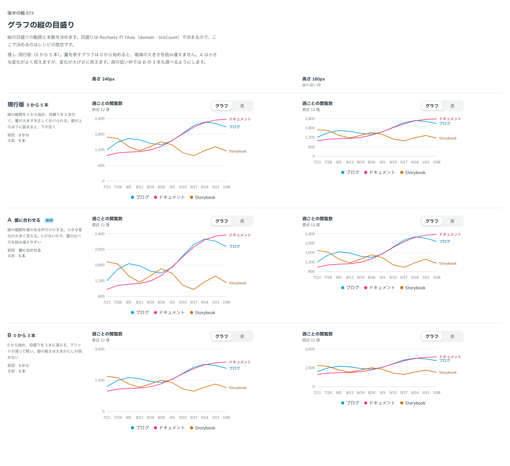

# 0545. グラフの縦の目盛りは、値に合わせた範囲が既定。ユーザー側で決められる

- ステータス: Accepted
- 日付: 2026-10-31
- ラウンド: 後半 軸 673

## 背景

縦の目盛りの範囲（0 から始めるか、値のある所だけにするか）と本数が決まっていませんでした。依頼の経緯は [ADR-0544](./0544-chart-axis-title.md) にあります。

## 候補

| 案              | 範囲         | 本数 |
| --------------- | ------------ | ---- |
| 現行版（zero）  | 0 から       | 5 本 |
| A（auto・採用） | 値に合わせる | 5 本 |
| B（few）        | 0 から       | 3 本 |

高さ 240px の枠と、背の低い 160px の枠で並べました。

## 決定

**縦の目盛りの範囲は、値に合わせるのが既定です（`yTicks="auto"`）。** 本数は 5 本です。0 から始めて 5 本引く `zero` と、0 から始めて 3 本に減らす `few` も選べます。

目盛りは Recharts の YAxis（domain・tickCount）で決まります。データの性質（量か、水準か）で適した範囲が変わるので、レシピの既定は見本としての値であり、写した側が決める前提です。

## 理由

ユーザーの返事の原文です。

> ユーザー側でカスタマイズしてもらう、な気が... 基本は A なのかなと

はじめは現行版（0 から 5 本）を推していました。量を表すグラフは 0 から始めると増減の大きさを読み違えず、A は変化が大げさに見えるためです。返事を受けて考え直しました。

- **範囲はデータ次第**: 0 から始めるべきなのは量のグラフで、気温や水準のグラフでは値のある所だけを見せるほうが読めます。部品が一つに決めると、どちらかの使い手に逆らいます
- **何も渡さなければ値を素直に映す**: 範囲を渡さない既定は、値に合わせた範囲です。部品側で 0 を足さないので、使い手の意図を勝手に変えません
- **注意は残す**: 値に合わせると小さな変化が大きく見えます。量の増減を伝えたいグラフでは、`zero` を選ぶよう案内します
- **few は背の低い枠のため**: 高さ 160px の枠では、5 本の横線が混み合います

## 却下した案と理由

- **現行版（0 から 5 本）を既定にすること**: 量のグラフには安全ですが、値が上のほうに固まると下が空きます。選べる形（`zero`）として残します
- **B を既定にすること**: 背の低い枠では有効ですが、高さ 240px では目盛りが粗すぎます

## 影響

- `src/recipes/line-chart/PageViewsLineChart.tsx`: look に `yTicks`（`auto`・`zero`・`few`。既定は `auto`）を足しました。`auto` は domain を `['auto', 'auto']`、`zero` と `few` は `[0, 'auto']` にし、`few` は tickCount を 3 にします
- 部品（`src/components/chart/`）は範囲を持ちません。範囲と本数は Recharts の props のままです

## 原則への反映

反映なし。部品は使い手のデータを知らないので範囲を決めない、という原則 20（部品は知らないことを決めない）を当てました。

決めた時点のコミットは `f29262ca` です（既定を反映したのは `2a4bd2c7`）。

## 比較画像

