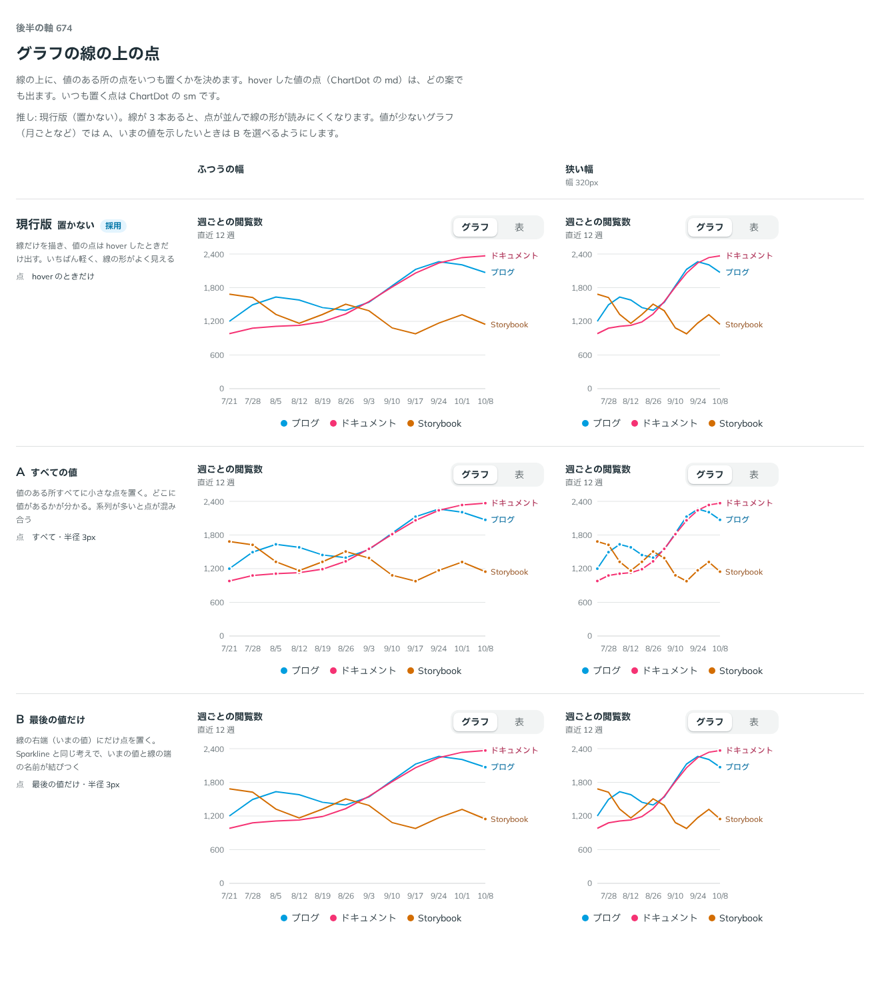

# 0546. グラフの線の上の点は、置かないのが既定。すべての値に置くこともできる

- ステータス: Accepted
- 日付: 2026-10-31
- ラウンド: 後半 軸 674

## 背景

線の上に、値のある所の点をいつも置くかが決まっていませんでした。依頼の経緯は [ADR-0544](./0544-chart-axis-title.md) にあります。hover した値の点（ChartDot の `md`）は、どの案でも出ます。ここで決めるのは、いつも置く点（ChartDot の `sm`）です。

## 候補

| 案                   | 点                     |
| -------------------- | ---------------------- |
| 現行版（none・採用） | hover のときだけ       |
| A（all・選べる形）   | すべての値・半径 3px   |
| B（last）            | 最後の値だけ・半径 3px |

## 決定

**線の上に点は置かないのが既定です（`dots="none"`）。** hover したときだけ点が出ます。

**`dots="all"` で、すべての値に小さな点を置けます。** 最後の値だけに置く案（`last`）は外しました。

## 理由

ユーザーの返事の原文です。

> 現行版で、A はありとして B はなしかな

現行版を推していたので、返事は推しのとおりでした。A を残すのは、返事が「ありとして」と言ったためです。

- **線の形がよく見える**: 線が 3 本あると、点が並んで線の形が読みにくくなります。点なしがいちばん軽く、傾きと交差がそのまま読めます
- **値が少ないときは all**: 月ごとなど値の数が少ないグラフでは、どこに値があるかを点が示します
- **last は外す**: 線の端の名前（ChartLineLabel）がいまの値を示す役目をすでに持っています。端の点だけを足しても、二重になります

## 却下した案と理由

- **B（最後の値だけ）**: ユーザーが「なし」と判断しました。選べる形にも残していません

## 影響

- `src/recipes/line-chart/PageViewsLineChart.tsx`: look に `dots`（`none`・`all`。既定は `none`）を足しました。`all` は Line の dot に ChartDot の `sm` を渡します。決めたあとの `2a4bd2c7` で、`last` の分岐を消しました
- `src/components/chart/ChartMarks.tsx`: ChartDot は `md`（hover した値）と `sm`（いつも置く点）の 2 つです。半径は `--chart-dot-radius`・`--chart-dot-sm-radius` です

## 原則への反映

反映なし。

決めた時点のコミットは `f29262ca` です（`last` を外したのは `2a4bd2c7`）。

## 比較画像

