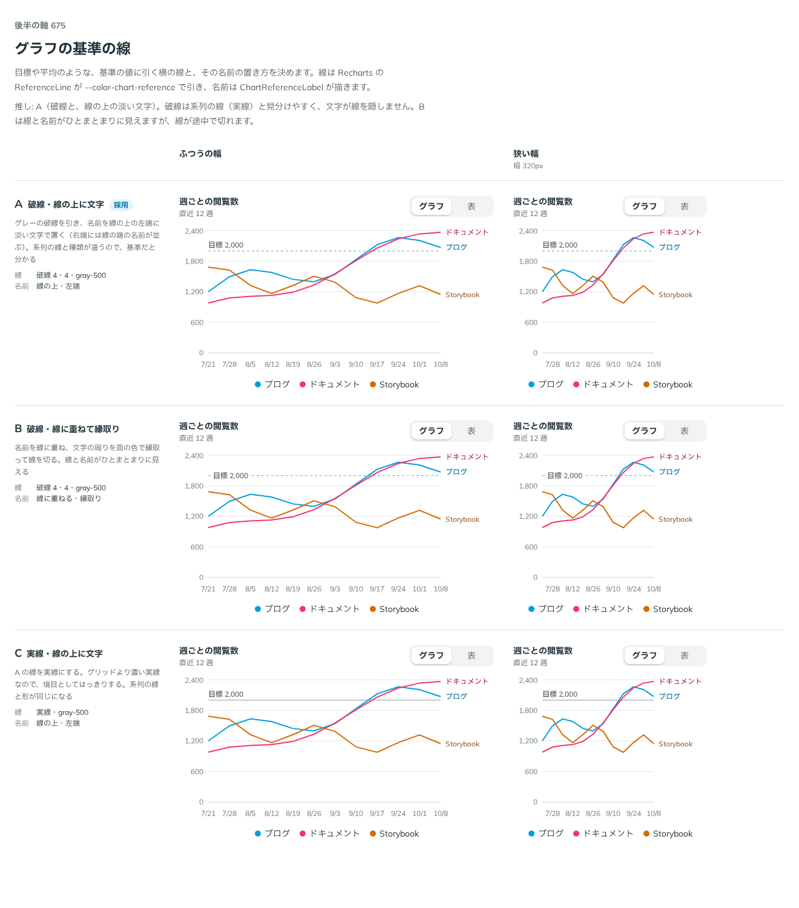

# 0547. グラフの基準の線は、グレーの破線に、線の上の淡い文字で名前を置く

- ステータス: Accepted
- 日付: 2026-10-31
- ラウンド: 後半 軸 675

## 背景

目標や平均のような、基準の値に引く横の線と、その名前の置き方が決まっていませんでした。依頼の経緯は [ADR-0544](./0544-chart-axis-title.md) にあります。

## 候補

| 案            | 線                   | 名前                       |
| ------------- | -------------------- | -------------------------- |
| A（採用）     | 破線（4・4）・グレー | 線の上・左端・淡い文字     |
| B（選べる形） | 破線（4・4）・グレー | 線に重ねる・面の色で縁取り |
| C             | 実線・グレー         | 線の上・左端・淡い文字     |

この軸には現行版がありません（基準の線は、これまで部品になかったものです）。

## 決定

**グレーの破線を引き、名前を線の上の左端に淡い文字で置くのが既定です（`referenceLine="dashed"`、`referenceLabel="plain"`）。** 名前を線に重ねて文字の周りを面の色で縁取る形（`halo`）と、実線（`solid`）も選べます。基準の線を引かないのが、レシピの既定の状態です（`none`）。

線は Recharts の ReferenceLine が `--color-chart-reference` で引き、名前は ChartReferenceLabel が描きます。

## 理由

ユーザーの返事の原文です。

> A

推しは A でした。

- **系列の線と見分けられる**: 系列の線は実線なので、破線にすれば基準だと分かります。C は線の形が系列と同じになり、グリッドより濃い実線が系列に見えます
- **名前が線を隠さない**: 名前を線の上に置けば、線は切れずに最後まで引かれます。B は線と名前がひとまとまりに見えますが、線が途中で切れます
- **左端に置く**: 右端には線の端の名前が並びます。左端なら重なりません

## 却下した案と理由

- **C（実線）**: 境目ははっきりしますが、系列の線と形が同じになります
- **B を既定にすること**: 面の色で縁取るので、グリッドや面の色が変わる場所では縁が目立ちます。選べる形としては残します

## 影響

- `src/components/chart/ChartMarks.tsx`: ChartReferenceLabel を足しました。`variant` は `plain`（線の上の淡い文字）と `halo`（面の色で縁取り）です。縁取りの太さは `--chart-reference-halo`（6px）です
- `src/components/chart/chart.tokens.css`: `--color-chart-reference`（線の色）を使います
- `src/recipes/line-chart/PageViewsLineChart.tsx`: look に `referenceLine`（`none`・`dashed`・`solid`）と `referenceLabel`（`plain`・`halo`）を足しました。名前は線の左端（縦の目盛りの幅のすぐ右）から置きます

## 原則への反映

反映なし。補助の線と文字を淡く置く既存の書き方に従います。

決めた時点のコミットは `f29262ca` です。

## 比較画像

