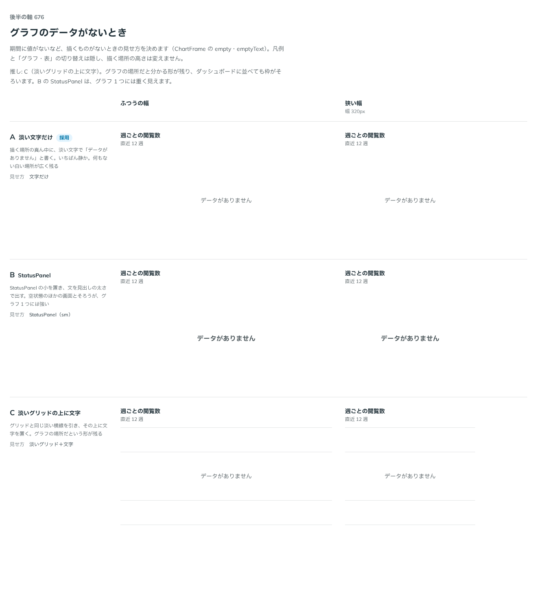

# 0548. グラフのデータがないときは、描く場所の真ん中に淡い文字だけを置くのが既定

- ステータス: Accepted
- 日付: 2026-10-31
- ラウンド: 後半 軸 676

## 背景

期間に値がないなど、描くものがないときの見せ方が決まっていませんでした。依頼の経緯は [ADR-0544](./0544-chart-axis-title.md) にあります。

## 候補

| 案                   | 見せ方                                 |
| -------------------- | -------------------------------------- |
| A（text・採用）      | 真ん中に淡い文字「データがありません」 |
| B（panel・選べる形） | StatusPanel の小（見出しの太さの文）   |
| C（grid・選べる形）  | 淡いグリッドの横線の上に文字           |

## 決定

**描く場所の真ん中に、淡い文字だけを置くのが既定です（`emptyVariant="text"`）。** 文言は `emptyText` で変えられ、既定は「データがありません」です。StatusPanel の小を置く `panel` と、淡いグリッドの線の上に文字を置く `grid` も選べます。

`empty` のあいだは、凡例と「グラフ・表」の切り替えを隠します。描く場所の高さは変えません。

## 理由

ユーザーの返事の原文です。

> A

はじめは C を推していました。グラフの場所だと分かる形が残り、ダッシュボードに並べても枠がそろうためです。返事を受けて考え直しました。

- **データがないことは、控えめに伝えれば足りる**: 空の状態を大きく見せると、並んだグラフの中でそこだけが目立ちます。淡い文字だけなら、いちばん静かです
- **余白の広さは高さで保つ**: 白い場所が広く残るのが A の難点でしたが、高さを変えないので、並んだ枠はそろいます
- **形を残したいときは grid、画面の空状態とそろえたいときは panel**: 選べるので、使い手が場面で決められます

## 却下した案と理由

- **B（StatusPanel）を既定にすること**: ほかの画面の空状態とそろいますが、グラフ 1 つには強く見えます
- **C を既定にすること**: 悪くありませんが、ユーザーは A を選びました。選べる形として残します

## 影響

- `src/components/chart/ChartFrame.tsx`: `empty`（boolean）、`emptyText`（ReactNode。既定は「データがありません」）、`emptyVariant`（`text`・`panel`・`grid`。既定は `text`）を足しました。`panel` は StatusPanel（`size="sm"`）を使います
- `src/recipes/line-chart/PageViewsLineChart.tsx`: 見本の Controls から `state: 'empty'` で確かめられます

## 原則への反映

反映なし。

決めた時点のコミットは `f29262ca` です。

## 比較画像

