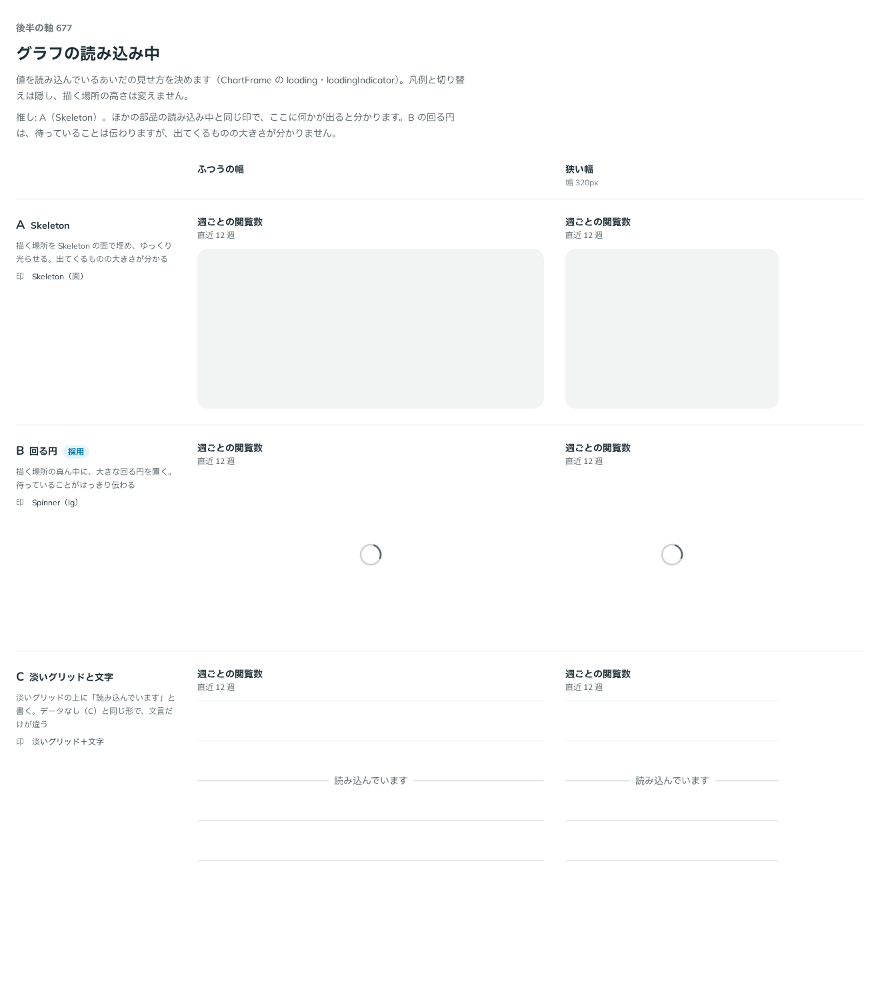

# 0549. グラフの読み込み中は、描く場所の真ん中に回る円を置くのが既定

- ステータス: Accepted
- 日付: 2026-10-31
- ラウンド: 後半 軸 677

## 背景

値を読み込んでいるあいだの見せ方が決まっていませんでした。依頼の経緯は [ADR-0544](./0544-chart-axis-title.md) にあります。

## 候補

| 案                      | 印                                         |
| ----------------------- | ------------------------------------------ |
| A（skeleton・選べる形） | Skeleton の面で描く場所を埋める            |
| B（spinner・採用）      | 真ん中に Spinner（lg）                     |
| C（grid・選べる形）     | 淡いグリッドの線の上に「読み込んでいます」 |

## 決定

**描く場所の真ん中に、大きな回る円（Spinner の lg）を置くのが既定です（`loadingIndicator="spinner"`）。** Skeleton の面で埋める `skeleton` と、淡いグリッドの線と文字の `grid` も選べます。文言は `loadingText` で変えられ、既定は「読み込んでいます」です。

`loading` のあいだは、凡例と「グラフ・表」の切り替えを隠します。描く場所の高さは変えません。

グラフの形をした Skeleton（線や軸の形を薄く描くもの）は、まだありません。backlog に送ります。

## 理由

ユーザーの返事の原文です。

> この中だと B かなと。A はグラフとしての見た目の Skeleton が別に必要かなと思っています

はじめは A を推していました。ほかの部品の読み込み中と同じ印で、ここに何かが出ると分かるためです。返事を受けて考え直しました。

- **今の Skeleton は四角の面**: 描く場所を四角で埋めても、出てくるのが線グラフなのか棒グラフなのかは分かりません。グラフの形を持つ Skeleton が別にあれば、A の狙い（出てくるものの大きさと形が分かる）を満たせます。それまでは、形を約束しない回る円のほうが正直です
- **待っていることがはっきり伝わる**: 回る円は、読み込み中だと一目で分かります
- **skeleton は残す**: 面で埋めたいという使い手もいるので、選べる形として残します。ただしグラフの形ではないという注意を、JSDoc とコードの注釈に書きました

## 却下した案と理由

- **A を既定にすること**: ユーザーの指摘のとおり、四角の面はグラフの Skeleton として足りません
- **C を既定にすること**: データがないときの `grid` と形が同じで、文言しか違いません。読み込み中と空を見分けにくくなります

## 影響

- `src/components/chart/ChartFrame.tsx`: `loading`（boolean）、`loadingText`、`loadingIndicator`（`spinner`・`skeleton`・`grid`。既定は `spinner`）を足しました。決めた時点では `skeleton` が先頭でしたが、`2a4bd2c7` で `spinner` に直しました
- `design/backlog.md`: グラフの形の Skeleton を未決として足します（メインが当てます）

## 原則への反映

反映なし。原則 14（動きは手応えと待ちを伝える）の、待ちを動きで伝える形です。

決めた時点のコミットは `f29262ca` です（既定を反映したのは `2a4bd2c7`）。

## 比較画像

