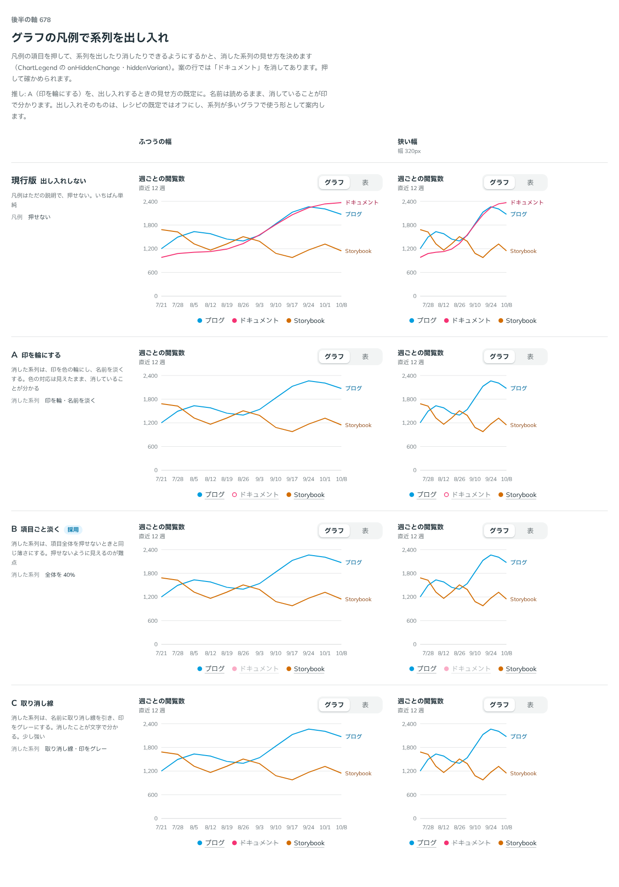

# 0550. 凡例の項目で系列を出し入れできる。押せる項目は名前に淡い下線を引き、消した系列は項目ごと淡くする

- ステータス: Accepted
- 日付: 2026-10-31
- ラウンド: 後半 軸 678

## 背景

凡例の項目を押して系列を出したり消したりできるようにするかと、消した系列の見せ方が決まっていませんでした。依頼の経緯は [ADR-0544](./0544-chart-axis-title.md) にあります。比較では「ドキュメント」の系列を消した状態で並べました。

## 候補

| 案               | 凡例                                       |
| ---------------- | ------------------------------------------ |
| 現行版           | 押せない。ただの説明                       |
| A（ring）        | 消した系列は印を色の輪にし、名前を淡く     |
| B（faded・採用） | 消した系列は項目全体を押せないときの薄さに |
| C（strike）      | 消した系列は名前に取り消し線、印をグレーに |

## 決定

**`ChartLegend` に `onHiddenChange` を渡すと、凡例の項目が系列を出し入れするボタンになります。** 渡さなければ、これまでどおり押せない説明です。出し入れは既定でオフ（レシピの `legendToggle` は `false`）で、系列が多いグラフで使う形として案内します。

**押せる項目は、名前に淡い下線を引きます。** 下線のボタン（Button の `variant="underline"`・`size="sm"`）と同じ高さ（36px）・左右の余白・角・hover と押したときの手応えにします。hover で文字の色を淡く敷き、押すと沈みます。

**消した系列は、項目全体を薄くするのが既定です（`hiddenVariant="faded"`）。** 印を色の輪にする `ring` と、取り消し線の `strike` も選べます。

## 理由

ユーザーの返事の原文です。

> 押せるなら下線ありの原則を適用した上で、B かな。出し入れは既定オフで良さそう

はじめは A を推していました。名前は読めるまま、消していることが印で分かるためです。返事を受けて考え直しました。

- **押せるなら下線あり**: 押せるものは、ふだんから押せると分かる見た目にします。凡例の項目は文字なので、名前に淡い下線を引きます（原則 7 の、いちばん軽い形）
- **B は、消えていることが一目で分かる**: 項目全体が薄くなれば、消えた系列が凡例の中で引っ込みます。「押せないように見えるのが難点」と比較で書きましたが、押せる項目は下線があるので、薄くなっても押せるとは見分けられます
- **既定はオフ**: 系列が 2〜3 本のグラフには、出し入れは要りません。要る場面（系列が多い）で、使い手が渡します

決めたあと、押せる範囲について次の返事がありました。

> 出し入れできる場合の系列の見た目は、Link のボタンの見た目の underline に近づけてほしいです。いまだと領域が小さすぎます。

最初の実装は、文字の周りにわずかな余白を取っただけの小さなボタンでした。指で押せる高さにするため、下線のボタンの `size="sm"` と同じ大きさ・手応えに直しました。直したものを見て、次の返事でした。

> よさそう

## 却下した案と理由

- **現行版（押せない）**: 凡例の役割は説明だけにとどまります。出し入れしたい場面があるため、選べる形に足しました。何も渡さなければこの形です
- **A（ring）を既定にすること**: 名前が読めて良い形ですが、ユーザーは B を選びました。選べる形として残します
- **C（strike）**: 消したことが文字で分かりますが、少し強いです。選べる形として残します

## 影響

- `src/components/chart/ChartLegend.tsx`: `onHiddenChange`（`(hidden, index) => void`。ADR-0243 に沿って、値を先に、何番目かを 2 つ目に渡します）と `hiddenVariant`（`faded`・`ring`・`strike`。既定は `faded`）を足しました。項目の `hidden` が消した状態です。押せるときのボタンは、`h-(--spacing-control-sm)`・`px-(--spacing-control-x-sm)`・`rounded-control` で、hover に `--color-flat-hover`、押したときに `--color-flat-press` と `--flat-press-depth` だけ沈みます。ボタンの左右の余白が項目のあいだになるので、あいだを詰め、外へはみ出させて文字の位置をそろえます
- `src/components/chart/ChartLegendButton.tsx`: 項目をボタンにする部分です
- `src/components/chart/chart.tokens.css`: 凡例のボタン専用の余白（`--chart-legend-button-pad`）は、ボタンの寸法に寄せたので消しました
- `src/recipes/line-chart/PageViewsLineChart.tsx`: look に `legendToggle`（既定は `false`）と `legendHiddenVariant` を足しました。消した系列は Line の `hide` で隠します

## 原則への反映

原則 6 に「凡例で系列を消しても、凡例からは外さず淡くし、残りの系列の色を付け直さない」を足しました。押せるものは下線ありとする、原則 7（塗りか枠線か）の、押すものの強さの節の「下線だけの形」と、押せる範囲を見た目の範囲にそろえる原則 17 を当てました。

決めた時点のコミットは `f29262ca` です（押せる項目の大きさを直したのは `551ab7c8`）。

## 比較画像

