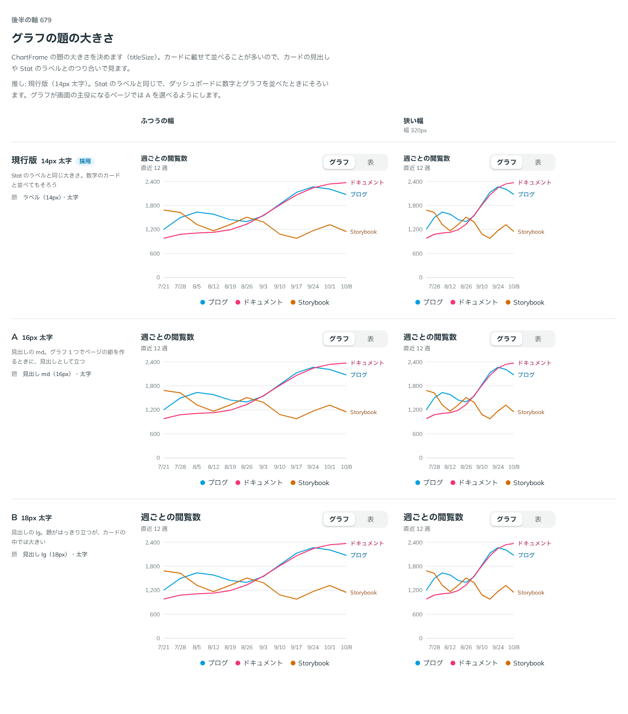

# 0551. グラフの題の大きさは、Stat のラベルと同じ小が既定。見出しの段も選べる

- ステータス: Accepted
- 日付: 2026-10-31
- ラウンド: 後半 軸 679

## 背景

ChartFrame の題の大きさが決まっていませんでした。依頼の経緯は [ADR-0544](./0544-chart-axis-title.md) にあります。グラフはカードに載せて並べることが多いので、カードの見出しや Stat のラベルとのつり合いで比べました。

## 候補

| 案                 | 題                       |
| ------------------ | ------------------------ |
| 現行版（sm・採用） | ラベルの段（14px）・太字 |
| A（md）            | 見出し md（16px）・太字  |
| B（lg）            | 見出し lg（18px）・太字  |

## 決定

**題はラベルの段（14px）・太字が既定です（`titleSize="sm"`）。** Stat のラベルと同じ大きさです。見出しの md（16px）と lg（18px）も選べます。

## 理由

ユーザーの返事の原文です。

> 選べる前提で、現行でいいかな。

現行版を推していたので、返事は推しのとおりでした。

- **数字のカードとそろう**: ダッシュボードに Stat とグラフを並べたとき、題とラベルの大きさがそろいます
- **カードの中では小さめが収まる**: lg はカードの中では大きく、題が内容より立ちます
- **主役のときは大きく**: グラフ 1 つでページの節を作るときは、md や lg で見出しとして立たせたくなります。選べるので、使い手が場面で決められます

## 却下した案と理由

- **A（md）・B（lg）を既定にすること**: カードに載せる並べ方が多く、既定としては大きすぎます。選べる形として残します

## 影響

- `src/components/chart/ChartFrame.tsx`: `titleSize`（`sm`・`md`・`lg`。既定は `sm`）を足しました。`sm` は Stat のラベルと同じ段、`md`・`lg` は見出しの段です
- `src/recipes/line-chart/PageViewsLineChart.tsx`: look の `titleSize` で、見本の Controls から切り替えられます

## 原則への反映

反映なし。

決めた時点のコミットは `f29262ca` です。

## 比較画像

